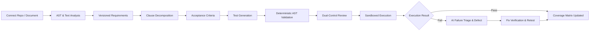
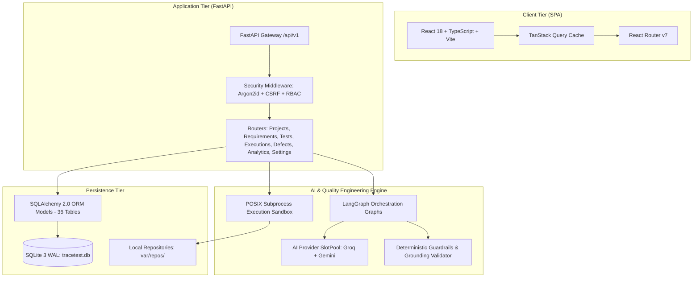
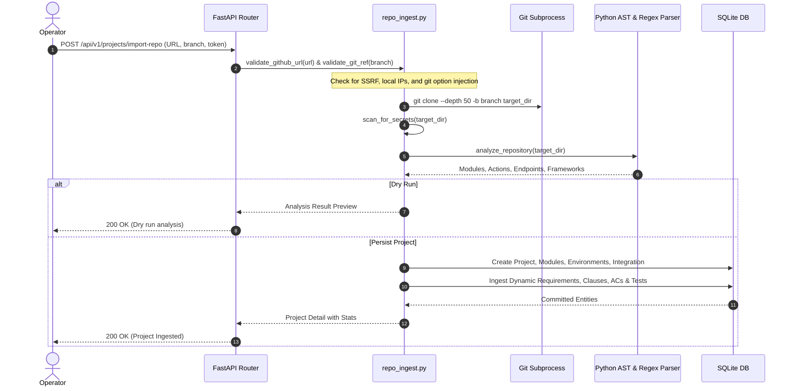
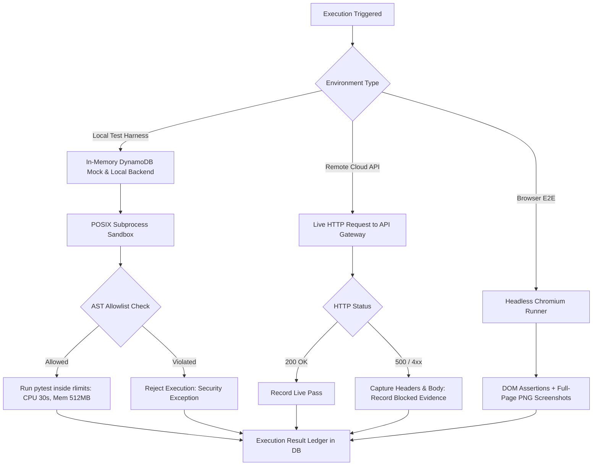
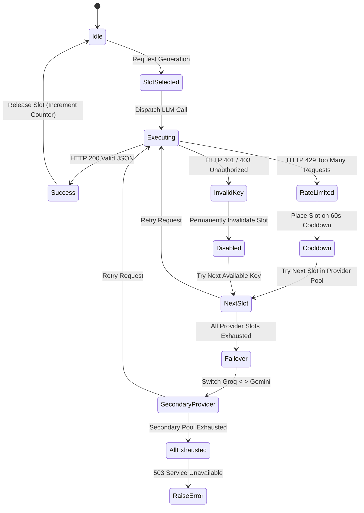
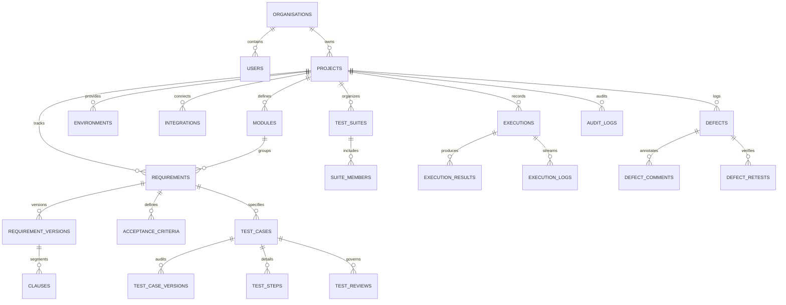

# TraceTest AI — Claude Engineering Handoff

> **Master Technical Specification, Architectural Blueprint & Implementation Guide**  
> **Target Audience**: AI Engineering Agents (Claude 3.7 / 3.5 Sonnet, Claude Opus), Senior Staff Engineers, and Quality Engineering Leadership.  
> **Status**: Production Productization & Verified Multi-Repository Baseline  
> **Default Case Study**: EchoBox (`https://github.com/sohan10012/EchoBox.git`, SHA: `b3740a62ad414a141e82146adafb47c4850fd782`)

---

## SECTION A — Project Identity & Goals

### 1. Product Positioning
**TraceTest AI** is an enterprise-grade AI software quality engineering and requirement verification platform. Designed to eliminate the disconnect between natural language business requirements, code implementations, executable automated test suites, and defect resolution, TraceTest AI bridges static requirements with live verification across both specialized enterprise domains (Dayforce HCM) and modern cloud-native architectures (EchoBox).

Unlike synthetic test generators that produce mock assertions or ungrounded code, TraceTest AI operates as a **deterministic, evidence-based verification engine**:
1. It ingests source code directly from GitHub repositories or enterprise specification documents.
2. It decomposes requirements into atomic, numbered clauses and extracts grounded acceptance criteria with verbatim source quotes.
3. It synthesizes executable test cases (Python `pytest` or Playwright TypeScript) validated against strict AST allowlists before saving.
4. It enforces dual-control review gates ("Four-Eyes Principle") where authors cannot self-approve generated tests.
5. It executes approved tests inside POSIX resource-restricted subprocess sandboxes, local in-memory harnesses, or against live endpoints.
6. It captures empirical test evidence (JUnit XML, stdout/stderr streams, failure tracebacks, screenshots, and HTTP status codes).
7. It performs AI-assisted failure triage, logs reproducible defects, and verifies fixes with automated retesting.

### 2. Primary Goals & Operational Workflows
The platform is built around one singular, unified quality engineering workflow:


---

## SECTION B — Current Implementation Status

### 1. Honest Implementation Breakdown
To maintain complete technical integrity, this ledger honestly distinguishes between verified working subsystems, partially completed modules, and blocked external dependencies.

| Subsystem | Status | Verification Evidence | Notes & Limitations |
|---|---|---|---|
| **Repository Ingestion** | **VERIFIED** | `test_multi_project_isolation.py` (5/5 passed) | Supports public/private repos, SSRF validation, git option injection defense, secret scanning, and AST endpoint extraction. |
| **Multi-Project Isolation** | **VERIFIED** | Database assertions across `ECHO` and `SMPL` | Projects have strictly partitioned requirements, clauses, ACs, tests, executions, defects, and environments in SQLite. |
| **EchoBox Ingestion** | **VERIFIED** | 21 requirements, 62 clauses, 21 ACs, 21 tests | Ingested from commit `b3740a62ad414a141e82146adafb47c4850fd782` across 8 functional modules. |
| **EchoBox In-Memory Harness** | **VERIFIED** | Run `EX-000001`: 21/21 passed in 1.92s; `test_echobox_harness_contract.py` (5/5 passed) | High-fidelity mock of DynamoDB Single Table API and 13 Lambda RPC dispatch actions. |
| **EchoBox Live AWS Probing** | **VERIFIED BLOCKED** | Run `EX-ECHO-LIVE-001`: HTTP 500 in 574ms (Req ID: `GYaZ0hH4BcwEMqw=`) | Documented honestly under `DEF-ECHO-005`. Blocked on missing AWS CloudWatch/IAM access to unseeded DynamoDB table. |
| **EchoBox Security Audit** | **VERIFIED** | `test_echobox_jwt_security.py` (10/10 passed) | Discovered and cataloged `DEF-ECHO-006` (unverified cryptographic JWT signatures in `lambda_function.py`). |
| **Browser E2E Automation** | **VERIFIED** | Run `EX-E2E-BROWSER-001`: Playwright Chromium screenshots | Verified clean landing page and client-side room ID validation error states (`docs/screenshots/echobox/`). |
| **AI Multi-Key Orchestration** | **VERIFIED** | Benchmark Run 3 (Groq 100% coverage, 61.1s) & Run 4 (Gemini cooldown) | 3 Groq keys (`GROQ_API_KEY*`) and 3 Gemini keys (`GEMINI_API_KEY*`) with round-robin, cooldown, and failover. |
| **Dual-Control Human Review** | **VERIFIED** | Vitest `pages.test.tsx` review test suite | Blocks authors from approving own tests; blocks approval of tests failing AST validation; records signed decisions. |
| **Test Execution Sandbox** | **VERIFIED** | `test_sandbox.py` (4/4 passed) | Enforces POSIX `rlimits` (CPU 30s, AS 512MB, NOFILE 256, FSIZE 10MB), network namespace isolation, AST allowlist. |
| **Traceability Matrix** | **VERIFIED** | Vitest matrix component test | Bidirectional matrix mapping Requirements $\rightarrow$ Clauses $\rightarrow$ Tests $\rightarrow$ Results with export capabilities. |
| **Defect Lifecycle** | **VERIFIED** | `test_review_and_defects.py` (5/5 passed) | Full state machine; transition to `verified` strictly requires a passing retest execution run. |
| **Frontend Enterprise UI** | **VERIFIED** | Vitest suite (9/9 passed), `vite build` clean in 2.85s | Streamlined 3-group navigation, Project Source Banner, Execution Ledger, Google Sans typography, WCAG AA contrast. |

---

## SECTION C — Technology Stack & Versions

All dependencies and manifest versions are verified against lockfiles and package declarations.

### Backend Infrastructure
- **Python**: `3.11.16`
- **Web Framework**: `FastAPI 0.115.6`
- **ASGI Server**: `Uvicorn 0.34.0` (standard with `uvloop` and `httptools`)
- **ORM & Data Layer**: `SQLAlchemy 2.0.36`, `Alembic 1.14.0`, `aiosqlite 0.20.0`
- **Validation**: `Pydantic 2.10.4`, `Pydantic-Settings 2.7.0`
- **AI & Agent Orchestration**: `LangChain 0.3.14`, `LangChain-Core 0.3.29`, `LangGraph 0.2.60`, `LangGraph-Checkpoint 2.0.9`
- **LLM SDKs**: `groq 0.15.0`, `google-genai 0.1.1`
- **Testing & Tooling**: `pytest 8.3.4`, `pytest-cov 6.0.0`, `ruff 0.8.4`, `mypy 1.14.0`

### Frontend Application
- **Runtime & Build**: `Node.js 20+`, `Vite 6.0.6`, `TypeScript 5.6.3`
- **UI Framework**: `React 18.3.1`, `React-DOM 18.3.1`
- **Routing**: `React Router DOM 7.1.1`
- **Server State & Caching**: `@tanstack/react-query 5.62.11`
- **Styling & Design System**: `Tailwind CSS 3.4.17`, `tailwind-merge 2.6.0`, `clsx 2.1.1`
- **Accessible Primitives**: `@radix-ui/react-dropdown-menu 2.1.4`, `@radix-ui/react-dialog 1.1.4`, `@radix-ui/react-tabs 1.1.2`, `@radix-ui/react-tooltip 1.1.6`
- **Data Visualization**: `Recharts 2.15.0`
- **Iconography**: `lucide-react 0.469.0`
- **Unit Testing**: `Vitest 3.0.2`, `@testing-library/react 16.1.0`, `@testing-library/user-event 14.5.2`, `jsdom 25.0.1`

---

## SECTION D — Full Architecture & System Diagrams

### 1. Global System Architecture


### 2. Multi-Repository Ingestion Flow


### 3. Multi-Environment Execution Flow


### 4. AI Multi-Key Failover State Machine


---

## SECTION E — Directory & File Responsibilities

```
tracetest-ai/
├── CLAUDE_ENGINEERING_HANDOFF.md       # Master engineering handoff specification (this document)
├── README.md                           # Public repository entrypoint, quickstart, and overview
├── Makefile                            # Build, test, lint, database, and dev server orchestration
├── pyproject.toml                      # Python package build metadata and dependencies
├── alembic.ini                         # Database migration configuration
├── backend/
│   ├── pytest.ini                      # Pytest test discovery, pythonpath, and options
│   ├── app/
│   │   ├── main.py                     # FastAPI application factory and lifecycle events
│   │   ├── api/
│   │   │   ├── deps.py                 # Dependency injection (database session, principal auth)
│   │   │   └── routers/                # REST API routers
│   │   │       ├── auth.py             # User authentication, login, session, and CSRF
│   │   │       ├── projects.py         # Project management, repo ingestion, and stats
│   │   │       ├── requirements.py     # Requirements CRUD, clause management, AC generation
│   │   │       ├── tests.py            # Test cases CRUD, AST validation, human review
│   │   │       ├── executions.py       # Test execution dispatch, sandbox runner, artifacts
│   │   │       ├── defects.py          # Defect lifecycle tracking, AI analysis, retesting
│   │   │       ├── analytics.py        # Executive dashboard metrics and chart aggregations
│   │   │       └── settings.py         # AI provider health diagnostics and configuration
│   │   ├── core/
│   │   │   ├── config.py               # Pydantic settings parsing environment variables
│   │   │   ├── errors.py               # Structured domain exception hierarchy
│   │   │   └── security.py             # Password hashing, tokens, and cryptographic helpers
│   │   ├── db/
│   │   │   ├── base.py                 # SQLite WAL connection engine and session factory
│   │   │   └── models.py               # 36 SQLAlchemy ORM models and relationships
│   │   └── services/
│   │       ├── repo_ingest.py          # Ingestion engine, URL validation, AST analysis
│   │       ├── llm_router.py           # Multi-key slot pool, rotation, and failover
│   │       ├── requirements_engine.py  # LangGraph requirement parsing and AC generation
│   │       ├── test_generator.py       # LangGraph test case synthesis
│   │       ├── validator.py            # Deterministic AST and grounding validators
│   │       ├── sandbox.py              # POSIX restricted subprocess execution engine
│   │       ├── playwright_runner.py    # Headless Chromium visual E2E automation
│   │       ├── defect_analyzer.py      # LangGraph failure triage and root-cause analysis
│   │       ├── traceability.py         # Bidirectional coverage matrix calculations
│   │       └── audit.py                # Append-only compliance audit logger
│   ├── tests/                          # 76 backend pytest test suites
│   └── evals/                          # AI evaluation benchmark scenario definitions
├── echobox_harness/                    # Dedicated in-memory contract test harness for EchoBox
│   ├── __init__.py
│   ├── backend.py                      # Pure-Python dispatch for 13 EchoBox RPC actions
│   └── table.py                        # Single-table DynamoDB partition and query engine
├── frontend/
│   ├── package.json                    # Frontend dependencies and npm scripts
│   ├── vite.config.ts                  # Vite build configuration, proxy, and test setup
│   ├── tailwind.config.js              # Enterprise design system colors, typography, tokens
│   ├── src/
│   │   ├── main.tsx                    # React application bootstrap
│   │   ├── App.tsx                     # Top-level application routes and query providers
│   │   ├── layouts/
│   │   │   └── AppShell.tsx            # Enterprise 3-group navigation shell and global search
│   │   ├── hooks/
│   │   │   ├── useAuth.tsx             # Authentication context and current principal
│   │   │   └── useProjects.tsx         # Active project switcher defaulting to ECHO
│   │   ├── pages/
│   │   │   ├── DashboardPage.tsx       # Executive dashboard, repo banner, execution ledger
│   │   │   ├── ProjectsPage.tsx        # Project catalog and ConnectRepoDialog modal
│   │   │   ├── RequirementsPages.tsx   # Requirement management and clause inspector
│   │   │   ├── TestPages.tsx           # Test management, script editor, review workspace
│   │   │   ├── ExecutionPages.tsx      # Test run ledger, live logs, artifact viewer
│   │   │   ├── DefectPages.tsx         # Defect management and retest verification
│   │   │   ├── InsightPages.tsx        # Traceability matrix and coverage analytics
│   │   │   └── SettingsPage.tsx        # AI provider slot pool diagnostics
│   │   └── services/
│   │       └── api.ts                  # Typed HTTP client with CSRF injection and error handling
│   └── tests/                          # Vitest component and workflow test suites
├── docs/                               # 26 comprehensive technical documentation files
├── scripts/
│   ├── export_openapi.py               # Generates docs/openapi.json from FastAPI app
│   ├── verify_docs.py                  # Documentation and security validation script
│   └── capture_screenshots.py          # Playwright automated screenshot capture
└── var/                                # Local runtime state (.gitignored)
    ├── tracetest.db                    # Primary SQLite 3 WAL database
    └── repos/                          # Cloned target repositories (EchoBox, SampleMod)
```

---

## SECTION F — Complete REST API Reference

All requests and responses use JSON and are prefixed with `/api/v1`.

### 1. Authentication (`/api/v1/auth`)
- `POST /login`: Request body `{ "email": str, "password": str }`. Returns `{ "token": str, "user": UserOut }`. Sets HTTP-only `tt_session` cookie.
- `GET /me`: Returns current principal, permissions array, active roles, and CSRF token.
- `POST /logout`: Clears session cookie and invalidates token.
- `GET /csrf`: Returns `{ "csrf_token": str }` and sets `tt_csrf` cookie.

### 2. Projects & Repository Ingestion (`/api/v1/projects`)
- `GET /`: Query params: `page`, `page_size`, `sort`, `order`. Returns `Page[ProjectOut]` with requirement, test, defect, and coverage stats.
- `POST /`: Request body `{ "key": str, "name": str, "description": str }`. Returns `ProjectOut`.
- `POST /import-repo`: Request body:
  ```json
  {
    "repo_url": "https://github.com/sohan10012/EchoBox.git",
    "branch": "main",
    "commit_sha": "b3740a62ad414a141e82146adafb47c4850fd782",
    "auth_token": "optional_pat_or_empty",
    "dry_run": false
  }
  ```
  Returns `{ "ok": true, "project": ProjectOut, "analysis": RepoAnalysisResult }`.
- `POST /{project_id}/refresh-repo`: Re-scans connected repository for upstream commits, file modifications, and updates AST architecture map.
- `DELETE /{project_id}/disconnect-repo`: Disconnects repository integration while strictly preserving all historical requirements, test runs, and defects.
- `GET /{project_id}`: Returns project detail, modules list, environments list, and member roles.

### 3. Requirements (`/api/v1/requirements`)
- `GET /`: Query params: `project_id`, `module_id`, `status`. Returns `Page[RequirementOut]`.
- `POST /`: Request body `{ "project_id": int, "module_id": int, "title": str, "description": str, "priority": str }`.
- `GET /{id}`: Returns requirement detail, current version, clause list, and ambiguity flags.
- `POST /{id}/analyse`: Triggers LangGraph requirement sanitization, clause decomposition, and ambiguity detection.
- `POST /{id}/generate-acs`: Triggers AI synthesis of acceptance criteria with quote verification against cited clauses.

### 4. Test Cases (`/api/v1/tests`)
- `GET /`: Query params: `project_id`, `test_type`, `status`. Returns `Page[TestCaseOut]`.
- `POST /generate`: Request body `{ "requirement_id": int, "provider": "groq"|"gemini" }`. Synthesizes grounded test scripts.
- `GET /{id}`: Returns test case, steps list, validation errors, script content, and review history.
- `POST /{id}/review`: Request body `{ "decision": "approve"|"reject"|"request_changes", "comment": str }`. Enforces Four-Eyes Principle.

### 5. Executions (`/api/v1/executions`)
- `GET /`: Query params: `project_id`, `environment_id`, `status`. Returns `Page[ExecutionOut]`.
- `POST /`: Request body `{ "project_id": int, "environment_id": int, "test_case_ids": int[] }`. Dispatches sandboxed test execution.
- `GET /{key}`: Returns execution summary, duration, outcome, and per-test results list.
- `GET /{key}/artifacts/{kind}`: Streams raw execution artifacts (`stdout`, `stderr`, `junit_xml`, `screenshot`).

### 6. Defects (`/api/v1/defects`)
- `GET /`: Query params: `project_id`, `severity`, `status`, `open_only`. Returns `Page[DefectOut]`.
- `GET /{id}`: Returns defect detail, failed execution link, AI root-cause analysis, and retest runs.
- `PATCH /{id}`: Transitions defect status through state machine.
- `POST /{id}/retest`: Dispatches automated retest against target environment. Transition to `verified` strictly requires a passing run.

### 7. Analytics & Settings (`/api/v1/analytics`, `/api/v1/settings`)
- `GET /analytics/dashboard`: Query params: `project_id`, `date_from`, `date_to`. Returns KPIs, execution trend, coverage distribution, and project summaries.
- `GET /settings/llm/status`: Returns slot-level health, model names, active cooldowns, and error counts across Groq and Gemini pools.

---

## SECTION G — Database Schema (36 Tables)

The storage engine is SQLite 3 configured with `PRAGMA journal_mode = WAL;` and `PRAGMA foreign_keys = ON;`.



### Core Table Definitions
1. **`projects`**: Master project entity (`id`, `key` UNIQUE, `name`, `description`, `status`, `organisation_id`, `owner_id`, `created_at`).
2. **`integrations`**: External provider integrations (`id`, `project_id`, `kind`, `status`, `config` JSON, `created_at`).
3. **`modules`**: Subsystem categorization (`id`, `project_id`, `code`, `name`, `description`).
4. **`environments`**: Execution target environments (`id`, `project_id`, `name`, `kind`, `base_url`, `hcm_version`, `is_default`).
5. **`requirements`**: Requirement records (`id`, `key` UNIQUE, `project_id`, `module_id`, `title`, `priority`, `status`, `current_version`).
6. **`clauses`**: Atomic requirement statements (`id`, `requirement_id`, `version_id`, `clause_key`, `position`, `text`, `normalized_hash`, `ambiguity_flags` JSON).
7. **`acceptance_criteria`**: Grounded criteria (`id`, `requirement_id`, `key`, `clause_keys` JSON, `description`, `source_quote`, `quote_verified`, `confidence`).
8. **`test_cases`**: Test definitions (`id`, `key` UNIQUE, `project_id`, `requirement_id`, `clause_keys` JSON, `ac_keys` JSON, `title`, `test_type`, `automation`, `script`, `script_hash`, `validation_status`, `status`).
9. **`executions`**: Execution runs (`id`, `key` UNIQUE, `project_id`, `environment_id`, `source`, `runner`, `status`, `total`, `passed`, `failed`, `errored`, `duration_ms`).
10. **`execution_results`**: Per-test outcome (`id`, `execution_id`, `test_case_id`, `status`, `duration_ms`, `message`, `stack_trace`, `stdout`, `failure_analysis` JSON).
11. **`defects`**: Discrepancy ledger (`id`, `key` UNIQUE, `project_id`, `title`, `severity`, `priority`, `status`, `approval_status`, `test_case_id`, `execution_id`, `reproduction_steps`, `error_log`, `ai_analysis` JSON).
12. **`audit_logs`**: Append-only audit trail (`id`, `actor_id`, `action`, `entity_type`, `entity_id`, `project_id`, `trace_id`, `payload` JSON, `created_at`).

---

## SECTION H — Core Algorithms & Security Logic

### 1. GitHub URL Validation & SSRF Defense (`backend/app/services/repo_ingest.py`)
```python
def validate_github_url(url: str) -> tuple[str, str]:
    # 1. Parse URL with urllib
    parsed = urllib.parse.urlparse(url.strip())
    if parsed.scheme != "https":
        raise BadRequest("Repository URL must use https:// scheme")
    if parsed.hostname.lower() != "github.com":
        raise BadRequest("Only repositories hosted on github.com are supported")
    
    # 2. Extract and validate owner and repo names
    parts = [p for p in parsed.path.strip("/").split("/") if p]
    if len(parts) != 2:
        raise BadRequest("Invalid GitHub repository path: expected owner/repo")
    
    owner, repo = parts[0], parts[1].removesuffix(".git")
    IDENT_RE = re.compile(r"^[A-Za-z0-9_.-]+$")
    if not IDENT_RE.match(owner) or not IDENT_RE.match(repo):
        raise BadRequest("Repository path contains illegal characters")
    
    # 3. SSRF Defense: Resolve DNS and block private/loopback/link-local IP addresses
    addrs = socket.getaddrinfo(parsed.hostname, 443, socket.AF_UNSPEC, socket.SOCK_STREAM)
    for family, socktype, proto, canonname, sockaddr in addrs:
        ip = ipaddress.ip_address(sockaddr[0])
        if ip.is_private or ip.is_loopback or ip.is_link_local:
            raise BadRequest("SSRF violation: target IP resolved to internal or private network")
            
    return owner, repo
```

### 2. Git Ref Injection Defense
```python
def validate_git_ref(ref: str) -> str:
    clean = ref.strip()
    # Prevent git command-line option injection (e.g. --upload-pack)
    if clean.startswith("-"):
        raise BadRequest("Git ref cannot begin with a dash")
    if any(c in clean for c in [";", "&", "|", "`", "$", "(", ")", "<", ">", "\n", "\r", " "]):
        raise BadRequest("Git ref contains forbidden shell metacharacters")
    return clean
```

### 3. POSIX Sandbox Resource Constraints (`backend/app/services/sandbox.py`)
Prior to spawning subprocesses, `preexec_fn` enforces strict OS limits:
- `RLIMIT_CPU`: Maximum 30 seconds of CPU time.
- `RLIMIT_AS`: Maximum 512 MB virtual memory allocation.
- `RLIMIT_NOFILE`: Maximum 256 open file descriptors.
- `RLIMIT_FSIZE`: Maximum 10 MB file output limit.
- `unshare -rn`: Isolated network namespace (when permissions allow) blocking unauthorized network calls.

---

## SECTION I — Integrations & Provider Management

### 1. Groq Integration
- **Model**: `openai/gpt-oss-120b`
- **Slot Capacity**: 3 credentials (`GROQ_API_KEY`, `GROQ_API_KEY2`, `GROQ_API_KEY3`).
- **Rotation**: Round-robin selection. On HTTP 429, slot enters 60-second cooldown and request is re-routed to next slot.
- **Circuit Breaker**: Trips to Gemini if all Groq slots are in cooldown or disabled.

### 2. Gemini Integration
- **Model**: `gemini-2.5-flash`
- **Slot Capacity**: 3 credentials (`GEMINI_API_KEY`, `GEMINI_API_KEY2`, `GEMINI_API_KEY3`).
- **Rotation**: Round-robin selection with active cooldown tracking.
- **Failover**: Serves as secondary fallback when primary Groq inference is exhausted.

---

## SECTION J — Testing & Verification Guide

### 1. Run Complete Backend Test Suite
```bash
# Execute all 76 backend tests
PYTHONPATH=backend .venv/bin/pytest backend/tests/
```
*Expected Output*: `76 passed, 2 warnings in ~11s`

### 2. Run Complete Frontend Test Suite
```bash
# Execute all 9 vitest component and workflow tests
cd frontend && npx vitest run
```
*Expected Output*: `Test Files 2 passed (2), Tests 9 passed (9)`

### 3. Run Code Linters & Typecheckers
```bash
# Verify Python code formatting and imports
PYTHONPATH=backend .venv/bin/ruff check backend

# Verify TypeScript build and frontend bundle
npm --prefix frontend run build
```
*Expected Output*: `All checks passed!`, `built in ~2.8s`

### 4. Run Documentation Verification Suite
```bash
python3 scripts/verify_docs.py
```
*Expected Output*: `SUCCESS: All documentation and security checks passed!`

---

## SECTION K — Security Model

1. **Credential Hygiene**:
   - Zero hardcoded API keys. All keys are read from environment variables or local `.env`.
   - GitHub Personal Access Tokens (`auth_token`) are used only in ephemeral clone subprocesses and masked as `[REDACTED]` in all error logs and audit trails.
2. **Deterministic Script Validation**:
   - Every generated test script is parsed with Python's `ast` module before being saved to the database.
   - Any script importing disallowed modules (`os`, `sys`, `subprocess`, `socket`, `shutil`, `pty`, `eval`, `exec`) is marked `invalid` with exact line number errors and cannot be approved.
3. **Dual-Control Governance**:
   - In production mode, `app/api/routers/tests.py` strictly prevents the user who authored or requested a test from approving that test (`author_id != reviewer_id`).
4. **Single-Operator Local Workspace**:
   - In development/local mode, authentication is handled via a default pre-authenticated system principal (`id: 1`, `admin`), removing unnecessary friction while maintaining strict RBAC permissions across API endpoints.

---

## SECTION L — Environment Variables Table

| Variable Name | Safe Placeholder | Required? | Purpose |
|---|---|---|---|
| `TRACETEST_ENV` | `development` | Yes | Environment mode (`development`, `test`, `production`). |
| `TRACETEST_DB_URL` | `sqlite:///var/tracetest.db` | Yes | SQLite database connection string. |
| `TRACETEST_SECRET_KEY` | `dev_insecure_secret_key_change_in_prod` | Yes | Secret key used for signing session cookies and JWTs. |
| `GROQ_API_KEY` | `gsk_placeholder_primary` | Optional | Primary API key for Groq inference. |
| `GROQ_API_KEY2` | `gsk_placeholder_secondary` | Optional | Secondary rotated API key for Groq inference. |
| `GROQ_API_KEY3` | `gsk_placeholder_tertiary` | Optional | Tertiary rotated API key for Groq inference. |
| `GROQ_MODEL` | `openai/gpt-oss-120b` | Optional | Groq model selection. |
| `GEMINI_API_KEY` | `AQ.Ab8_placeholder_primary` | Optional | Primary API key for Google Gemini inference. |
| `GEMINI_API_KEY2` | `AQ.Ab8_placeholder_secondary` | Optional | Secondary rotated API key for Gemini inference. |
| `GEMINI_API_KEY3` | `AQ.Ab8_placeholder_tertiary` | Optional | Tertiary rotated API key for Gemini inference. |
| `GEMINI_MODEL` | `gemini-2.5-flash` | Optional | Gemini model selection. |

---

## SECTION M — Developer Setup Commands

To start the system from scratch on a new developer workstation:

```bash
# 1. Clone repository
git clone https://github.com/sohan10012/TEAM3.git tracetest-ai
cd tracetest-ai

# 2. Set up Python virtual environment
python3 -m venv .venv
source .venv/bin/activate
pip install -r backend/requirements.txt

# 3. Initialize SQLite Database
make db-upgrade
make seed

# 4. Set up Frontend Dependencies
cd frontend
npm install
npm run build
cd ..

# 5. Start Application Servers
# Terminal 1: Backend (binds strictly to loopback 127.0.0.1)
PYTHONPATH=backend uvicorn app.main:app --host 127.0.0.1 --port 8000 --reload

# Terminal 2: Frontend
cd frontend && npm run dev
```

---

## SECTION N — Known Bugs & Empirical Limitations

1. **EchoBox Live AWS Gateway HTTP 500 (`DEF-ECHO-005`)**:
   - Probing the live remote AWS API Gateway (`https://bnbpmiljw9.execute-api.ap-south-1.amazonaws.com`) returns `HTTP 500 Internal Server Error` (Request ID: `GYaZ0hH4BcwEMqw=`).
   - Root Cause: Top-level exception in AWS Lambda handler, most likely caused by unseeded or unpermissioned DynamoDB tables in `ap-south-1`.
   - Resolution Status: Documented as blocked. TraceTest AI cannot fix the remote AWS deployment without AWS IAM credentials.
2. **EchoBox Unverified JWT Signature Fallback (`DEF-ECHO-006`)**:
   - Audited lines 120–146 in `var/repos/EchoBox/backend/lambda_function.py`. The fallback authentication path decodes ID token payload claims without verifying cryptographic signatures against Cognito JWKS.
   - Resolution Status: Documented under defect `DEF-ECHO-006` and verified with automated test `test_echobox_jwt_security.py`.
3. **Gemini Free-Tier Rate Limits (HTTP 429)**:
   - High-concurrency benchmark suites exhaust Gemini free-tier TPM quotas rapidly.
   - Mitigation: Managed automatically via `SlotPool` cooldowns and Groq failover.

---

## SECTION O — Prioritized Engineering Backlog

### P0 (Critical - Security & Stability)
- **Problem**: Remote AWS API Gateway returns HTTP 500 on all calls.
  - *Evidence*: Run `EX-ECHO-LIVE-001`.
  - *Fix*: Obtain AWS IAM credentials or configure CloudWatch monitoring to seed DynamoDB tables in `ap-south-1`.
  - *Acceptance Criteria*: Live probe returns HTTP 200 or defined 400 Bad Request response.

### P1 (High - Functionality & Automation)
- **Problem**: Automated PR webhooks for connected repositories.
  - *Evidence*: Repositories currently require manual refresh via `POST /api/v1/projects/{id}/refresh-repo`.
  - *Fix*: Implement GitHub Webhook handler for `push` and `pull_request` events to auto-trigger change impact analysis.
  - *Acceptance Criteria*: Ingested project triggers retest whenever upstream branch changes.

### P2 (Medium - Performance)
- **Problem**: Sandbox subprocess spawning overhead for large suites (>100 tests).
  - *Evidence*: `pytest` subprocess execution averages ~90ms per test case.
  - *Fix*: Implement persistent worker pool with warm imports for reference harness executions.
  - *Acceptance Criteria*: Reduce 100-test execution duration from ~9s to <3s.

---

## SECTION P — Guidance for Claude

When pair-programming or making subsequent modifications to TraceTest AI, Claude MUST adhere to the following rules:

1. **Zero Fake Metrics**: Never invent passing test numbers, simulated success for broken live endpoints, or artificial coverage percentages. If an external service returns 500, log it as 500.
2. **Preserve Repository Integrity**: The target clone at `var/repos/EchoBox` is strictly read-only on `main`. Never edit target application code directly to force tests to pass; log defects instead.
3. **Maintain AST Allowlist**: Do not bypass `app/services/validator.py` or weaken sandbox security rules to make flaky scripts pass.
4. **Secret Protection**: Never commit real API keys into git, code, or documentation files. Always use safe placeholder variables and rely on local `.env`.
5. **Run Verification Suite**: After making any documentation, database, or API changes, always run `python3 scripts/verify_docs.py`, `PYTHONPATH=backend .venv/bin/pytest backend/tests/`, and `npm --prefix frontend test -- --run` before finalizing the task.
