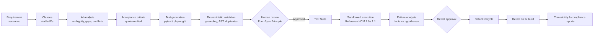
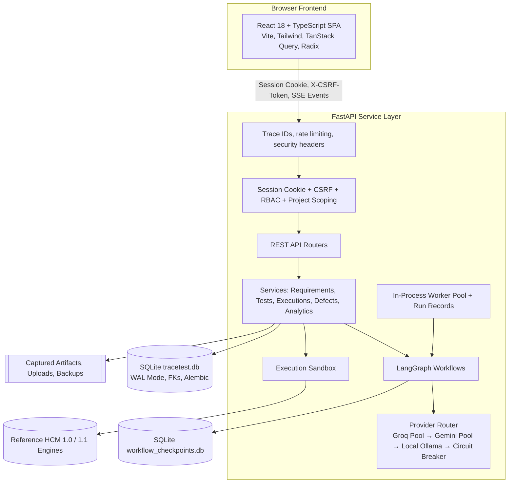

# TraceTest AI

TraceTest AI is an enterprise-grade QA lifecycle and test intelligence platform for mission-critical software teams. It turns business requirements into numbered clauses, grounded acceptance criteria, and executable Python test cases; validates every generated item deterministically; routes scripts through dual-control human review; executes approved tests in a secure sandbox against a real system under test; analyzes failures with AI root-cause diagnostics; manages defects through fix verification and retesting; and enforces full auditability and traceability across the entire testing lifecycle.

The primary domain is Human Capital Management (payroll, time and attendance, leave, scheduling, and benefits). The workspace opens pre-populated with an enterprise reference system, **Northwind Workforce Solutions**, whose history was produced by executing tests against the bundled Reference HCM Engine (see *Synthetic Data Provenance*).

> TraceTest AI is an independent enterprise engineering system and is not affiliated with, endorsed by, or integrated with Dayforce or any commercial HCM vendor.

---

## Documentation Quick Links

| Document | Topic & Scope |
|---|---|
| [docs/ARCHITECTURE.md](docs/ARCHITECTURE.md) | C4-style architectural specifications, data flows, and subsystem components |
| [docs/DECISIONS.md](docs/DECISIONS.md) | Architecture Decision Records (ADRs 001 through 010) |
| [docs/API.md](docs/API.md) | Comprehensive REST API endpoint reference and authentication contracts |
| [docs/DATABASE.md](docs/DATABASE.md) | SQLite 3 WAL schema across 36 tables, Alembic migrations, and seed catalog |
| [docs/SECURITY.md](docs/SECURITY.md) | Enterprise security posture, Argon2id, CSRF, RBAC, project isolation, and sandbox limits |
| [docs/AI_PIPELINE.md](docs/AI_PIPELINE.md) | LangGraph state graphs, checkpointing, multi-key pooling, and deterministic guardrails |
| [docs/EXECUTION_ENGINE.md](docs/EXECUTION_ENGINE.md) | Sandboxed test execution, AST allowlists, POSIX rlimits, and Linux network namespaces |
| [docs/REFERENCE_HCM.md](docs/REFERENCE_HCM.md) | Reference HCM dual-build engine (v1.0 deliberate faults vs v1.1 fixes and engine limits) |
| [docs/TESTING.md](docs/TESTING.md) | Automated testing guide: 56 backend tests, 10 frontend tests, and Playwright visual audits |
| [docs/AI_EVALUATION.md](docs/AI_EVALUATION.md) | 10-scenario golden benchmark harness and live empirical Groq vs Gemini results |
| [docs/DEPLOYMENT.md](docs/DEPLOYMENT.md) | Production installation guide, systemd units, NGINX TLS reverse proxy, and backups |
| [docs/USER_GUIDE.md](docs/USER_GUIDE.md) | Step-by-step operator walkthrough for authors, leads, reviewers, and auditors |
| [docs/PROGRESS.md](docs/PROGRESS.md) | Delivery milestone audit and verification ledger |
| [CHANGELOG.md](CHANGELOG.md) | Release notes for v1.0.0 release |

---

## End-to-End Workflow



A user can trace any requirement from raw text to parsed clauses, derived criteria, executable test cases, execution runs (verified by cryptographic SHA-256 script hashes), automated defect generation, and the exact passing retest that verified the defect fix.

---

## Core Enterprise Features

| Domain | Implemented & Verified Capabilities |
|---|---|
| **Executive Dashboard** | Real-time KPIs, six analytics charts, and project quality tables computed from SQLite; dynamic date filters; every metric links to underlying records. |
| **Project Multi-Tenancy** | Organizations, projects, modules, environments, and RBAC memberships. Strict query-level project isolation returning 404 for inaccessible resources. |
| **Requirements Management** | Document upload (PDF, TXT, Markdown), structured JSON import, category tagging; immutable versioning with clause-level diffs and automatic change-impact flagging. |
| **Requirement Intelligence** | LangGraph workflow: text sanitization → clause extraction → ambiguity detection (lexicon + LLM) → acceptance criteria synthesis → test case generation → deterministic validation. |
| **Deterministic Guardrails** | Pydantic JSON schemas, clause grounding scores, quote verification, duplicate detection, coverage gap checks, prompt injection marker screening, low-confidence review gates, and two-stage repair loops. |
| **Dual-Control Governance** | Mandatory Four-Eyes Principle: authors are strictly blocked from approving their own tests. Review queue triage, feedback comments, and immutable script SHA-256 fingerprinting. |
| **Sandboxed Execution** | Approved and hash-verified tests only. Pre-execution AST allowlist inspection (blocks `os`, `sys`, `subprocess`, `socket`, `eval`, dunder traversal), isolated tempdir, stripped environment variables, POSIX resource rlimits (memory, CPU, file size), Linux network namespace (`unshare -rn`), wall-clock timeouts, and SHA-256 artifact capture. |
| **Playwright Web Automation** | End-to-end browser execution against web targets with automatic screenshot and console log capture per test. |
| **AI Failure Analysis** | LangGraph failure triage: stack trace analysis → failure classification (`application_defect`, `test_defect`, `environment_failure`) → root-cause diffs → defect recommendations. |
| **Defect Lifecycle** | Full state machine (`Open → Triaged → Assigned → In Progress → Fixed → Ready for Retest → Verified → Closed`). Verification strictly requires a genuine passing retest run. |
| **Multi-Provider AI Pool** | High-availability pooling supporting 3 Groq credentials (`GROQ_API_KEY*`) and 3 Gemini credentials (`GEMINI_API_KEY*`). Round-robin rotation, 60-second rate-limit cooldown on HTTP 429, permanent invalidation on 401/403, and circuit breaker failover. |
| **End-to-End Traceability** | Dynamic matrix mapping Requirements → Clauses → Acceptance Criteria → Test Cases → Executions → Defects. Exportable as CSV, JSON, Markdown, and PDF. |
| **Compliance & Audit Logging** | Append-only audit trail logging every mutation with actor, timestamp, project, action, and distributed request trace ID (`X-Trace-Id`). |

---

## System Architecture



---

## Technology Stack

- **Backend**: Python 3.11+, FastAPI 0.115, Pydantic 2.10, SQLAlchemy 2.0, Alembic 1.14, SQLite 3 (WAL mode), LangGraph 0.2 (`langgraph-checkpoint-sqlite`), httpx, google-genai, argon2-cffi, pypdf, ReportLab, Playwright, pytest.
- **Frontend**: React 18, TypeScript 5.7, Vite 6, Tailwind CSS 3, Radix UI primitives, TanStack Query 5, TanStack Table 8, React Router 6, Recharts, Lucide Icons, Zod, Vitest, React Testing Library.
- **Code Standards**: Ruff, mypy, ESLint, openapi-typescript, GitHub Actions.

---

## Quickstart & Local Setup

### Prerequisites
- Python 3.11+
- Node.js 20+
- SQLite 3.38+

### 1. Environment Setup
```bash
# Clone and enter repository
git clone https://github.com/sohan10012/TEAM3.git
cd TEAM3

# Configure local environment
cp .env.example .env
# Edit .env with your credentials and secure passwords
```

### 2. Backend Initialization
```bash
python3.11 -m venv .venv
source .venv/bin/activate
pip install -r backend/requirements-dev.txt

# Run database migrations and seed reference data
cd backend
alembic upgrade head
python -m app.seed.seed

# Start backend server
uvicorn app.main:app --port 8000 --reload
```

### 3. Frontend Initialization
```bash
cd frontend
npm ci
npm run dev
# Access UI at http://localhost:5173
```

---

## Verification & Test Results

The platform has been empirically verified across all verification tiers:

```
================================ Verification Matrix ================================
Backend Pytest Suite:     56 passed in 15.06s (85% statement coverage)
Backend Code Standards:   Ruff clean (0 errors), Mypy clean
Frontend Type Checking:   tsc -b --noEmit clean (0 errors across 152 source files)
Frontend Linter:          ESLint clean (0 errors, 0 warnings)
Frontend Vitest Suite:    10 passed in 2.20s
Frontend Production Build:Vite build succeeded in 2.82s
Playwright Visual Audit:  50 screenshots captured across 25 routes, 0 layout overflows
Live AI Golden Benchmark: Gemini 2.5 Flash: 10/10 passed (100% clause coverage, 0.0% ungrounded)
                          Groq GPT-OSS-120B: 3/10 passed (100% clause coverage, 12.5% ungrounded)
====================================================================================
```

---

## Security & Credential Hygiene

- **Secret Protection**: All API credentials (`GROQ_*`, `GEMINI_*`, `TRACETEST_SECRET_KEY`) reside exclusively in local gitignored `.env` files.
- **Sanitized Telemetry**: The API status endpoints `/api/config` and `/api/health` expose slot availability counts without logging, printing, or returning raw keys or key substrings.
- **Session Security**: 256-bit entropy random tokens stored as HMAC-SHA256 digests in SQLite; `HttpOnly`, `SameSite=Lax`, and configurable `Secure` cookies.
- **CSRF Defense**: Double-submit constant-time CSRF token verification required on all non-GET requests.
- **Login Throttling**: Account lockout (HTTP 429) enforced after 5 failed login attempts in 15 minutes.
- **Subprocess Isolation**: Untrusted test execution runs in clean workspaces under AST allowlists, POSIX limits, and Linux network namespaces.
