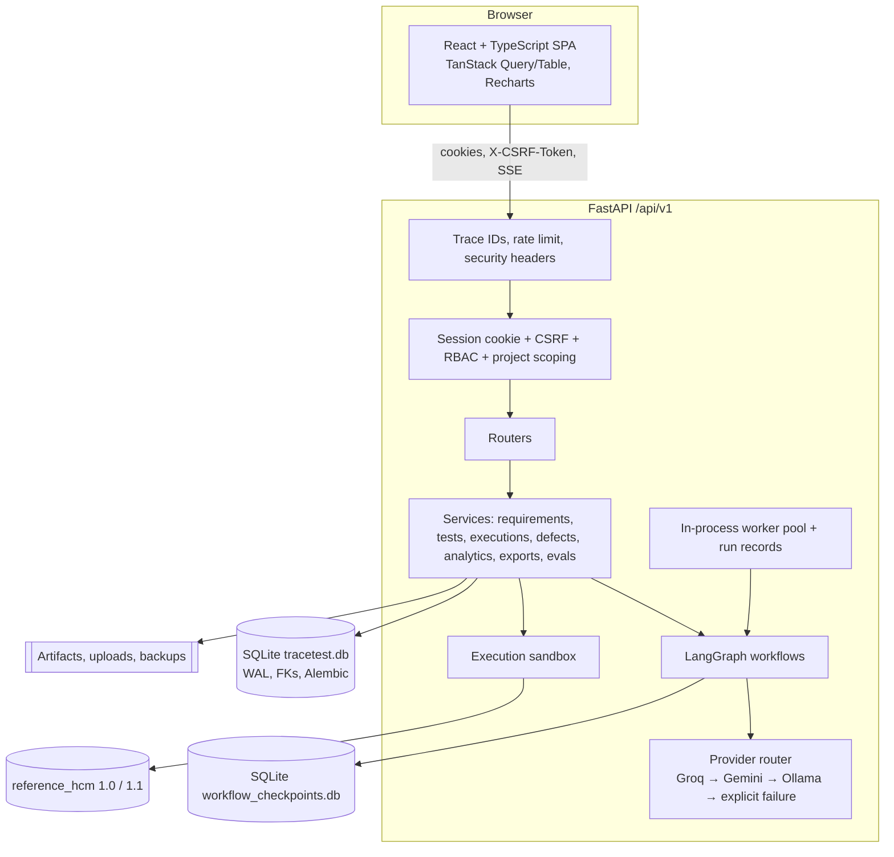

# TraceTest AI

TraceTest AI is a QA lifecycle and test intelligence platform for enterprise software teams. It turns business
requirements into numbered clauses, grounded acceptance criteria and test cases; validates every generated item
deterministically; routes it through human review; executes approved tests in a restricted sandbox against a real
system under test; analyses failures; manages defects through fix verification and retest; and reports quality from
the resulting records.

The first domain is Human Capital Management (payroll, time and attendance, leave, scheduling, benefits). The
workspace opens pre-populated with a fictional company, **Northwind Workforce Solutions**, whose history was produced
by actually executing its tests against the bundled Reference HCM Engine (see *Synthetic data provenance*).

> TraceTest AI is not affiliated with, endorsed by, or integrated with Dayforce or any other HCM vendor.

---

## Contents

- [Workflow](#workflow) · [Features](#features) · [Architecture](#architecture) · [Technology](#technology-stack)
- [Installation](#installation) · [Configuration](#configuration) · [Database](#database-initialisation)
- [Testing](#testing) · [Evaluation](#ai-evaluation) · [Security](#security) · [Limitations](#limitations)

## Workflow

```mermaid
flowchart LR
  R[Requirement<br/>versioned] --> C[Clauses<br/>stable IDs]
  C --> A[AI analysis<br/>ambiguity, gaps, conflicts]
  A --> AC[Acceptance criteria<br/>quote-verified]
  AC --> T[Test generation<br/>pytest / manual]
  T --> V[Deterministic validation<br/>grounding, AST, duplicates]
  V --> H{Human review}
  H -->|approved| S[Suite]
  S --> X[Sandboxed execution<br/>Reference HCM 1.0 / 1.1]
  X --> F[Failure analysis<br/>facts vs hypotheses]
  F --> D{Defect approval}
  D --> L[Defect lifecycle]
  L --> RT[Retest on fix build] --> Q[Traceability & quality reports]
```



A user can follow a requirement from its text to clauses, criteria, tests, every execution result (with the exact
script SHA-256 that ran), the defects raised from those failures, and the retest that verified the fix.

## Features

| Area | What is implemented |
|---|---|
| Dashboard | KPIs, six charts and project quality table computed from SQLite; project and date filters; every metric links to records |
| Projects | Create, edit, archive/restore, modules, environments (Reference HCM or web), membership; project-level data isolation in the API |
| Requirements | Create, edit, PDF/TXT/Markdown upload, structured JSON import, categories, priorities, modules, status; immutable versions with clause-level diff and change-impact analysis that marks affected approved tests `needs_reapproval` |
| Requirement intelligence | LangGraph workflow: sanitise → clause parser → ambiguity detector (lexicon + LLM) → acceptance criteria → tests → edge cases → validator → gap checker → persisted human-review interrupt |
| Guardrails | Pydantic schemas, clause grounding, normalised quote verification, duplicate detection, coverage gaps, ambiguity lexicon, prompt-injection markers with delimited untrusted input, low-confidence review rule, maximum two repair attempts then manual authoring |
| Review | Approve, reject, request changes (comment required), bulk approve/reject, authors cannot self-approve, validation failures block approval, every decision audited, edits create new test versions |
| Suites | Create, edit, add/remove tests (bulk from the test list), module grouping, suite coverage, execution history |
| Execution | Approved + validated + hash-matched tests only; AST allowlist re-check; isolated temp dir; empty environment; `python -I`; rlimits; network namespace when available plus socket guard; hard timeout; output cap; junit parsing; logs and junit stored as artifacts; reruns of failed tests on any environment; cancel |
| Playwright | Web environments run Playwright tests with screenshots and console logs captured per test |
| Failure analysis | LangGraph: precheck → deterministic classifier → LLM evidence analysis (optional) → defect recommendation → persisted human-approval interrupt → creation |
| Defects | Full lifecycle `Open → Triaged → Assigned → In Progress → Fixed → Ready for Retest → Verified → Closed` plus `Reopened`; verification requires a genuine passing retest; comments, links, duplicate warnings, Markdown/JSON reports |
| GitHub | Repository verification, branches, issue creation and status sync, export of approved tests; nothing is reported as created without GitHub's confirmation |
| CI/CD | GitHub Actions workflow (lint, types, OpenAPI drift, tests, Reference HCM regression matrix) and an authenticated junit ingestion endpoint that persists CI executions |
| Traceability | Clause × test matrix with coverage, untested clauses, orphan, duplicate and impacted tests; every cell links to its record |
| Analytics | Release readiness, requirement and automation coverage, defect density and ageing, regressions, change impact; CSV, JSON, Markdown and PDF exports |
| AI evaluations | 10 golden HCM scenarios; eight metrics; Groq, Gemini, Ollama or the labelled fixture baseline; history of real runs only |
| Audit | Append-only audit log with actor, record, source and request trace ID |

## Architecture



More detail: [docs/architecture.md](docs/architecture.md), decisions: [docs/DECISIONS.md](docs/DECISIONS.md).

Repository layout:

```
backend/app/{api,core,db,domain,graph,llm,guardrails,services,execution,integrations,seed}
backend/{migrations,tests,evals}     frontend/src/{components,pages,layouts,hooks,services,types,utils}
reference_hcm/{v1_0,v1_1}            samples/hcm   docs   scripts   .github/workflows
```

## Technology stack

Backend: Python 3.11+, FastAPI 0.115, Pydantic 2.10, SQLAlchemy 2.0, Alembic 1.14, SQLite, LangGraph 0.2 with
`langgraph-checkpoint-sqlite`, httpx (Groq OpenAI-compatible API, Ollama, GitHub REST), `google-genai` (Gemini),
argon2-cffi, pypdf, ReportLab, Playwright, pytest. Frontend: React 18, TypeScript 5.7, Vite 6, Tailwind CSS 3,
Radix primitives with shadcn-style components, TanStack Query 5 and Table 8, React Router 6, Recharts, lucide-react,
Zod, Vitest + Testing Library. Tooling: Ruff, mypy, ESLint, openapi-typescript, GitHub Actions. All versions are
pinned (`backend/requirements*.txt`, `frontend/package.json` + lockfile).

## Installation

Requirements: Python 3.11+, Node.js 20+.

```bash
make setup                 # writes .env with random dev passwords, creates .venv, installs dependencies
make backend               # http://127.0.0.1:8000 (first start migrates and seeds, ~5-10 s)
make frontend              # http://localhost:5173 (proxies /api to the backend)
```

Without `make`:

```bash
python scripts/bootstrap_env.py
python -m venv .venv && .venv/bin/pip install -r backend/requirements-dev.txt
cd backend && ../.venv/bin/uvicorn app.main:app --port 8000      # terminal 1
cd frontend && npm ci && npm run dev                              # terminal 2
```

**Development sign-in.** Three accounts are created: `admin@northwind-hcm.example` (admin),
`qa.engineer@northwind-hcm.example` (QA engineer) and `reviewer@northwind-hcm.example` (reviewer). Their passwords are
read only from `TRACETEST_ADMIN_PASSWORD`, `TRACETEST_QA_PASSWORD` and `TRACETEST_REVIEWER_PASSWORD`;
`make env` generates them into `.env`. An account with no password configured cannot sign in. The reviewer is
deliberately not a member of the Benefits project, which demonstrates project isolation.

## Configuration

All settings are environment variables (see [.env.example](.env.example)). The most important:

| Variable | Purpose |
|---|---|
| `TRACETEST_DATA_DIR` | Persistent data directory (database, checkpoints, artifacts, uploads, backups). Relative paths resolve from the repository root. |
| `TRACETEST_SECRET_KEY` | HMAC key for session-token hashing |
| `GROQ_API_KEY`, `GROQ_MODEL` | Primary provider, default `openai/gpt-oss-120b` |
| `GEMINI_API_KEY`, `GEMINI_MODEL` | Backup provider (hosted, not open-weight) |
| `OLLAMA_BASE_URL`, `OLLAMA_MODEL` | Optional local inference, disabled unless set |
| `TRACETEST_LLM_MODE` | `live` (default) or `mock`. Mock fixtures are only used when set explicitly (tests and CI). |
| `TRACETEST_EXEC_TIMEOUT`, `TRACETEST_EXEC_MEMORY_MB`, `TRACETEST_EXEC_MAX_OUTPUT` | Sandbox limits |
| `TRACETEST_CHROMIUM_EXECUTABLE` | Browser binary for Playwright runs when bundled browsers are not installed |
| `GITHUB_TOKEN` | Enables GitHub integration |
| `TRACETEST_CI_TOKEN` | Enables `POST /api/v1/ci/results` |

**Without API keys** the application starts and is fully browsable. Analysis, generation and AI failure analysis
show a "not configured" state pointing to Settings; deterministic features (clause parsing, ambiguity lexicon,
validation, execution, deterministic failure classification, defects, reports) keep working. No fixture output is
ever substituted in live mode.

## Database initialisation

On startup the API: applies Alembic migrations → creates roles, organisation and dev accounts → seeds the dataset
(once; guarded by a `seed.completed` audit record) → runs every approved script against Reference HCM 1.0 and 1.1 →
stores the results → validates `PRAGMA integrity_check` and `foreign_key_check` → marks runs interrupted by a
previous shutdown as failed. Restarting does not duplicate records.

Utilities: `python scripts/db.py {migrate|init|integrity|backup|restore PATH|reset}`. Backups use SQLite's online
backup API and are integrity-checked; restore takes a safety backup first. `reset` is developer-only (refuses unless
`TRACETEST_ENV` is `development` or `test`) and is not exposed in the UI. Administrators can trigger a backup from
Settings. Schema: [docs/database-schema.md](docs/database-schema.md).

Seeded quantities on a fresh database (queried from SQLite): 5 projects, 12 modules, 68 requirements (5 unanalysed),
122 requirement versions, 454 clause rows across all versions, 242 acceptance criteria, 266 test cases, 1,010 test
steps, 30 suites, 105 historical executions, 3,249 execution results, 41 defects (2 awaiting approval), 985 audit
records, 260 reviews. Clause and test counts sit slightly below the brief's target ranges; consistency was
prioritised over volume.

## Synthetic data provenance

All seeded data is fictional and generated offline by deterministic templates (`backend/app/seed`, seed
`20261105`). Expected values in seeded tests are derived from the requirement text, never from the implementation.
Historical executions (`source = historical_import`) are created by genuinely running each approved script once
per engine build in the sandbox; because the engine is deterministic, each historical execution record reuses that
real outcome for the exact script hash it lists. Seeded AI-style metadata is marked `provider = seed_import`, no
provider traces or evaluation scores are seeded, and the UI distinguishes historical imports from platform runs.

## AI orchestration

Two LangGraph graphs with a SQLite checkpointer (`backend/app/graph`). Deterministic Python handles clause IDs,
quote matching, coverage, deduplication, status transitions, script validation, IDs and audit; the LLM handles
interpretation, ambiguity suggestions, criteria, tests, edge cases and failure explanations. Work is batched per
group of four clauses. Results are cached by prompt hash. Every provider call is traced (provider, model, latency,
attempt, tokens, status) without recording keys.

Provider behaviour: per-call timeout; bounded retries with exponential backoff and jitter (longer for HTTP 429);
per-provider circuit breaker; fallback Groq → Gemini → Ollama; if all fail the run is marked `degraded`, partial
deterministic results are kept, errors are shown in the UI and the user can retry.

## Guardrails

Every generated criterion and test must cite clause keys of the current version and include a quotation that
matches the cited clause after normalisation (case, whitespace, typographic quotes, optional ellipsis). Items that
fail are not saved and are reported in the run. Requirement text is wrapped in `<<<UNTRUSTED_…>>>` delimiters and
scanned for injection markers. Generated scripts must pass the AST allowlist before they can be approved. Items under
60% confidence need a reviewer comment to approve.

## Execution engine

See [docs/execution-engine.md](docs/execution-engine.md) and [docs/reference-system.md](docs/reference-system.md).
Reference HCM 1.0 contains eight documented faults (HCM-F01…F08); 1.1 fixes them. In the seeded data, 58 approved
tests fail on 1.0 and 6 on 1.1: two are genuine test-automation defects (a mistyped module name) and four expose a
real gap (the engine does not support group-specific shift differential rates), which stays open as a defect.

## Defect management

Recommendations from failure analysis are created with `approval_status = recommended`; a reviewer approves (with
optional severity/priority adjustment) or dismisses them, which resumes the persisted LangGraph checkpoint. A defect
can only be marked Verified after a retest execution in which its linked test genuinely passed; a failing retest
reopens it.

## GitHub integration

Configure a repository per project under Integrations (verified against the GitHub API when `GITHUB_TOKEN` is set).
Approved defects can be raised as issues; the issue URL and number are stored only after GitHub returns them, and
status can be synced. Approved pytest scripts can be exported to `tracetest/` in the repository. Without GitHub,
every defect downloads as Markdown or JSON. GitHub was not exercised against a real account in this build (no
token was available): it is implemented and its failure handling is tested, but it is **not externally verified**.

## Testing

```bash
make test        # backend: pytest + coverage; frontend: vitest
make lint        # ruff + eslint
make typecheck   # mypy + tsc
```

Backend tests (55) cover guardrails, the sandbox (fault detection, rejection, timeout, output cap), the provider
router (repair, give-up, 429 fallback, timeouts, circuit breaker, no silent mock), auth/CSRF/throttling/rate
limiting/roles/isolation, data integrity and idempotence, OpenAPI drift, uploads, GitHub failure, CI ingestion,
evaluations, SSE, and a full end-to-end workflow from requirement to verified defect. Coverage: 86% overall;
guardrails 90–100%, graphs 93–96%, core services 80–97%. Frontend tests (10) cover components, form validation, the
server-side table, dashboard data, the traceability matrix, review workflow and navigation.

## AI evaluation

Golden scenarios live in `backend/evals/golden_scenarios.json`. Metrics: clause coverage, ungrounded output rate,
duplicate rate, schema-pass rate, ambiguity recall, traceability, average repair attempts and failure-classification
accuracy. Run from the AI Evaluations screen or `POST /api/v1/evaluations/run`. **No Groq or Gemini evaluation has
been run for this build** (no keys were available); see [docs/eval-report.md](docs/eval-report.md).

## Security

Argon2 password hashing; random session tokens stored only as HMAC hashes; HttpOnly, SameSite=Lax cookies
(`Secure` configurable); double-submit CSRF header on every mutation; login throttling (5 failures / 15 minutes per
account); per-session API rate limit; RBAC enforced in the API; project isolation returning 404 for inaccessible
records; input validation everywhere; upload type and size checks; secrets only from the environment and never
returned by the API; audit logging; sandboxed execution. Details and limitations: [docs/security.md](docs/security.md).

## Model licensing and acceptable use

`openai/gpt-oss-120b` is an open-weight model released under Apache 2.0 and served here through Groq, subject to
Groq's terms and usage policies. Gemini is a hosted Google model governed by the Gemini API terms and Google's
prohibited-use policy. Ollama models carry their own licences. Only the fictional sample requirements are sent to a
provider unless a user enters their own text; organisations must confirm their data-handling obligations before
sending real requirements to a hosted provider.

## Limitations

- Single-process deployment: background work runs in an in-process thread pool and the rate limiter is per process;
  SQLite suits a team-sized installation, not horizontal scaling.
- The sandbox is process-level isolation (rlimits, clean env, isolated interpreter, network namespace where the OS
  allows it), not a container or VM. On Windows, rlimits and network namespaces are unavailable; only timeouts,
  the AST allowlist, the socket guard and process groups apply.
- Playwright runs need network access to the target and a browser; they skip the address-space limit.
- API response bodies are typed by hand in `frontend/src/types/models.ts`; request bodies use types generated from
  `docs/openapi.json`.
- Real-provider AI quality, GitHub and CI ingestion from a live GitHub workflow have not been verified externally.
- Fonts load from Google Fonts; offline installs fall back to system sans-serif.

## Future extensions

CRM, SCM and ERP reference systems behind the same execution contract; container-based sandboxing; SSO (OIDC/SAML);
PostgreSQL option for multi-node deployments; Jira integration; scheduled regression runs.
