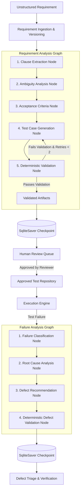
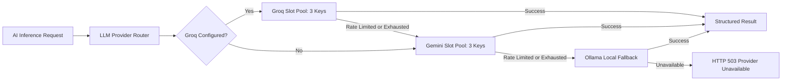

# TraceTest AI — AI Pipeline & LangGraph Orchestration

TraceTest AI combines **LangGraph** workflow orchestration with deterministic safety gates and multi-provider LLM failover. The system transforms unstructured requirements into executable, traceable test cases and analyzes test execution failures without human hallucinations.

---

## 1. Pipeline Architecture Overview



---

## 2. LangGraph State Graphs & Checkpoint Persistence

### 2.1 State Graph Checkpointing
Every graph invocation is assigned a persistent thread ID (`thread_id`). State transitions are checkpointed to `var/workflow_checkpoints.db` using `langgraph.checkpoint.sqlite.SqliteSaver`.
- **Fault Tolerance**: If the backend process restarts during an LLM inference call, the workflow state can be resumed from the last persisted checkpoint without re-running prior nodes.
- **Audit Trace**: Graph history provides an immutable sequence of state changes and intermediate tool/model outputs.

### 2.2 Requirement Analysis Graph
- **Input State**: `requirement_id`, `version_number`, `raw_text`, `project_key`.
- **Node Pipeline**:
  1. `extract_clauses`: Parses text into atomic, numbered clauses (`clause_number`, `text`).
  2. `analyze_ambiguity`: Scans each clause for underspecified verbs, vague quantifiers ("fast", "approximate", "reasonable"), and passive voice. Computes `ambiguity_score` (0.0 - 1.0).
  3. `generate_criteria`: Synthesizes Given-When-Then acceptance criteria tied to each clause. Generates both positive and negative boundary criteria.
  4. `generate_test_cases`: Produces executable test scenarios with concrete step sequences and expected outcomes.
  5. `validate_tests`: Deterministic evaluation checking clause grounding (minimum 80% coverage), duplicate step detection, and AST syntax validation. If validation fails and retry count is under the limit, the graph loops back with error feedback.

### 2.3 Failure Analysis Graph
- **Input State**: `execution_id`, `test_case_id`, `error_message`, `stack_trace`, `execution_log`, `sut_version`.
- **Node Pipeline**:
  1. `classify_failure`: Categorizes failure into `application_defect`, `test_defect`, `environment_failure`, or `flaky_test`.
  2. `analyze_root_cause`: Extracts specific assertion diffs, expected vs actual values, and code references.
  3. `recommend_defect`: Proposes structured defect title, severity, reproduction steps, and suggested resolution.
  4. `validate_defect`: Verifies grounding against the test script and execution logs.

---

## 3. Multi-Provider & Multi-Credential Pooling

TraceTest AI supports high-availability inference across **Groq**, **Google Gemini**, and local **Ollama** backends.



### 3.1 Managed Slot Pool (`SlotPool`)
Both Groq and Gemini integrations maintain an active pool of credential slots (`GROQ_API_KEY`, `GROQ_API_KEY2`, `GROQ_API_KEY3` and `GEMINI_API_KEY`, `GEMINI_API_KEY2`, `GEMINI_API_KEY3`).
- **Round-Robin Rotation**: Requests cycle through active slots to balance rate limits evenly across accounts.
- **Automatic Cooldown on HTTP 429**: When a slot encounters a rate limit or quota exceeded error, it is placed in a temporary cooldown window (default: 60 seconds). Subsequent requests bypass this slot until the cooldown expires.
- **Auth Invalidation on HTTP 401/403**: A slot that fails authentication is marked permanently invalid for the lifetime of the process, preventing repeated wasted calls.
- **Provider Status Telemetry**: The router exposes `/api/config` and `/api/health` slot status (active count, cooldown count, disabled count) with **zero secret or key-substring leakage**.

---

## 4. Structured Output Enforcement & Repair Loops

All LLM calls require structured JSON conforming to Pydantic schemas.

```python
class GeneratedTestCase(BaseModel):
    title: str = Field(..., max_length=200)
    description: str
    clause_references: list[int]
    steps: list[TestStepSchema]
    is_negative: bool = False
```

### 4.1 Schema Repair Protocol
LLM outputs occasionally contain markdown formatting (````json ... ````), conversational text, or trailing commas. TraceTest AI applies a two-stage repair protocol:
1. **Deterministic Sanitizer**: Strips markdown fencing, extracts JSON payloads between braces, and normalizes escaping.
2. **Schema Validation**: Validates the sanitized payload against Pydantic models.
3. **LLM Schema Repair**: If JSON syntax or schema validation fails, the error message and raw output are sent back to the model with an explicit repair prompt (up to `max_retries=2`).

---

## 5. Deterministic Grounding & Anti-Hallucination Guardrails

TraceTest AI strictly separates generative suggestions from deterministic verification:
- **Ungrounded Rate**: Every generated acceptance criterion must cite specific clause numbers. Acceptance criteria referencing non-existent clauses are flagged as ungrounded and rejected.
- **Duplicate Prevention**: Generated test cases undergo pairwise similarity analysis (normalized Levenshtein and Jaccard token overlap). Duplicates exceeding a 0.85 similarity threshold are automatically pruned.
- **Human Approval Barrier**: The LLM cannot mark a test case as approved or executable. Only an authorized human reviewer can transition a test to `approved`.
- **Immutable Script Hash**: When a test is approved, a SHA-256 hash of the exact Python code is recorded. The execution engine refuses to run any test whose database hash does not match its current script.
