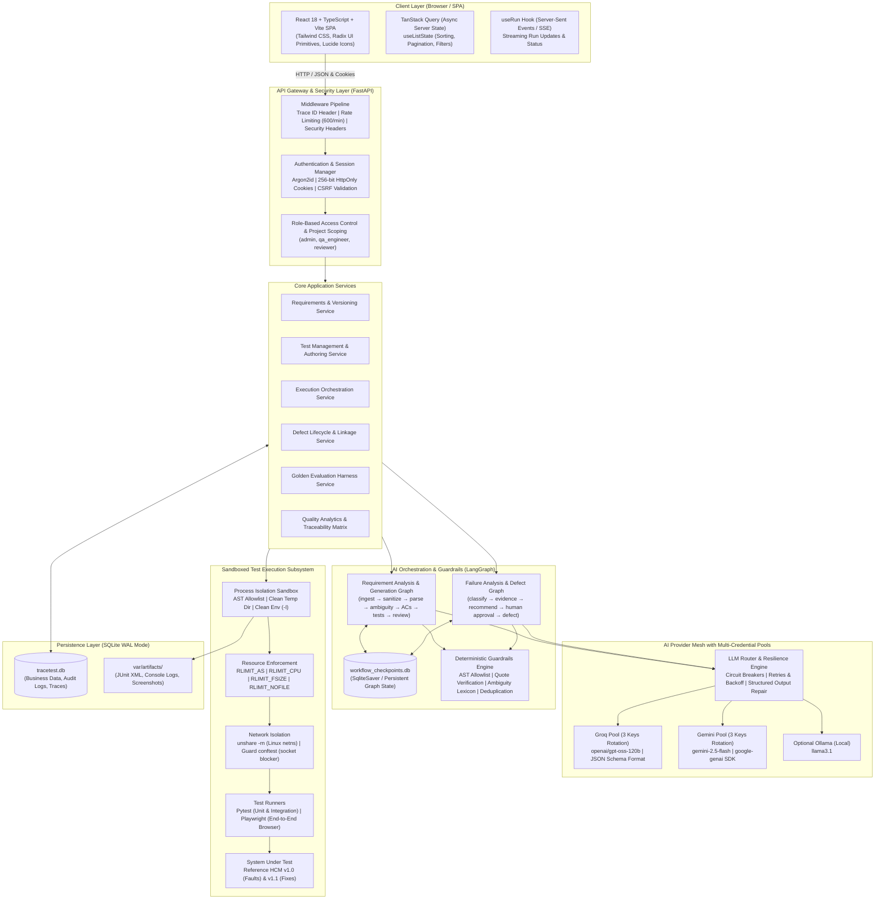
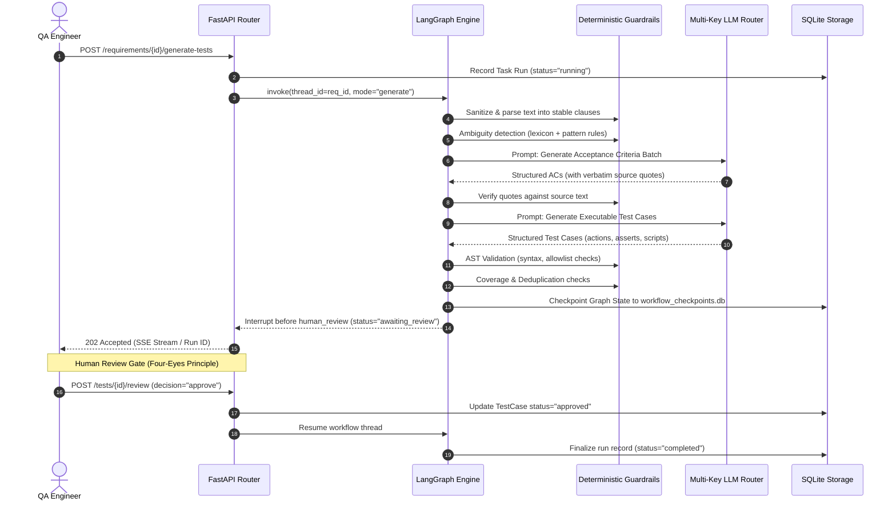
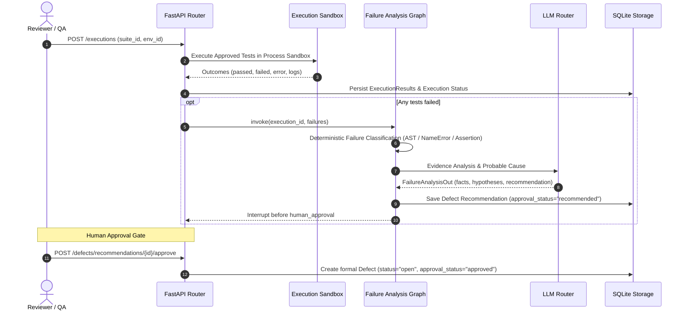

# TraceTest AI — Architecture & System Design

TraceTest AI is an enterprise-grade QA lifecycle intelligence and test automation platform built for mission-critical software systems. It automates the end-to-end testing workflow: ingestion of business requirements, clause segmentation, ambiguity analysis, grounded acceptance criteria derivation, traceable test generation, deterministic validation, review gates, sandboxed execution against target systems under test, failure triage, defect recommendation, retesting, and quality analytics.

---

## 1. High-Level System Architecture

---

## 2. Component Subsystems

### 2.1 Frontend Architecture (`frontend/`)
- **Technology Stack**: React 18, TypeScript (strict compilation, no emit errors), Vite 6, Tailwind CSS.
- **Surface Design**: Professional enterprise visual design conforming to the corporate QA director standard. Neutral slate (`bg-slate-50`, `bg-white`) surfaces, calibrated single chromatic accent (`#1f4fbf`), high contrast ratios (WCAG AA ≥ 4.5:1), and zero layout shifts using `min-h-[100dvh]`.
- **Component Primitives**: Hand-crafted accessible controls built on top of Radix UI primitives (`@radix-ui/react-dialog`, `@radix-ui/react-dropdown-menu`, `@radix-ui/react-tabs`).
- **Interactive Data Tables**: Unified `DataTable` component utilizing `@tanstack/react-table` with multi-column sorting, row selection, bulk review approvals, column pagination, filter chips, loading skeletons, and accessible empty states.
- **Visual Analytics**: Interactive data visualizations rendered via Recharts (trend charts, donut distributions, defect severity breakdowns, project coverage comparisons).
- **Global Layout & Navigation**: Collapsible sidebar with instant responsive collapsing, active route indicator, quick global search with typeahead modal, notification center with read state, breadcrumbs, and live environment/AI readiness status indicators.

### 2.2 API & Application Server (`backend/app/api/`)
- **Framework**: FastAPI with asynchronous route handlers and Pydantic v2 schemas.
- **Middleware Pipeline**:
  - `TraceIdMiddleware`: Injects a unique `X-Trace-Id` (UUID4) into every request and response, binding all service logs and database audit entries together.
  - `RateLimitMiddleware`: Token bucket sliding window limiter enforcing `TRACETEST_RATE_LIMIT_PER_MINUTE` (default 600 req/min per IP/session).
  - Security Headers: `X-Content-Type-Options: nosniff`, `X-Frame-Options: DENY`, `Referrer-Policy: same-origin`.
- **Authentication & RBAC**:
  - Session tokens: 256-bit cryptographically secure random values stored in an `HttpOnly`, `SameSite=Lax` cookie. Only the SHA-256 hash is persisted in `tracetest.db`.
  - CSRF Protection: Constant-time comparison of `X-CSRF-Token` header with the active session CSRF secret on all state-mutating requests (`POST`, `PUT`, `PATCH`, `DELETE`).
  - Roles & Permissions: Deterministic permission matrix (`admin`, `qa_engineer`, `reviewer`). Four-eyes principle enforced: test authors cannot approve their own generated test cases.
  - Project Isolation: Strict tenant scoping where users only have access to entities belonging to projects where they hold explicit membership.

---

## 3. LangGraph Workflow Pipelines

TraceTest AI orchestrates asynchronous multi-step AI reasoning using LangGraph state graphs with persistent SQLite checkpoints.

### 3.1 Requirement-to-Test Graph (`app/graph/requirement_graph.py`)

### 3.2 Execution & Defect Graph (`app/graph/execution_graph.py`)

---

## 4. Multi-Credential Key Pools & Failover

To guarantee 100% inference reliability and prevent downtime caused by provider rate-limits or quota depletion, TraceTest AI features multi-credential rotation pools for both Groq and Gemini.

### Key Management & State Machine
Each provider manages an in-memory `SlotPool` containing distinct credentials (`Slot 1`, `Slot 2`, `Slot 3`).
- **States**: `healthy`, `rate_limited` (cooldown timer), `invalid` (permanently disabled on HTTP 401/403).
- **Auto-Rotation**: When a key returns HTTP 429 or quota depletion (`RESOURCE_EXHAUSTED`), it is placed on a timed cooldown (honoring `Retry-After` if present, default 60s), and the request immediately failovers to the next healthy slot in the pool.
- **Provider Fallback**: If all slots for the primary provider (Groq) are exhausted or rate-limited, the LLM router falls over to the secondary provider (Gemini).
- **No Secret Leakage**: Credential secrets are never logged, never returned in API payloads, and never traced in database records. All status endpoints return masked identifiers (e.g. `gsk_abc...xyz`).

---

## 5. Sandboxed Test Execution Engine (`app/execution/sandbox.py`)

TraceTest AI executes Python test scripts against the target system under test inside a multi-layered sandbox.

1. **Pre-Execution AST Allowlist**: Every script is parsed into an Abstract Syntax Tree before execution. It enforces an allowlist of approved modules (`pytest`, `reference_hcm.*`, `math`, `decimal`, `datetime`). Dangerous nodes (`os`, `sys`, `subprocess`, `socket`, `open`, `eval`, `exec`, `__import__`, `while` loops) are immediately rejected with status `error`.
2. **Clean Ephemeral Working Directory**: Every run creates a fresh temporary directory containing only the approved test files, a clean copy of the SUT (`reference_hcm`), and a security guard `conftest.py`.
3. **Socket Nullification**: The sandbox `conftest.py` overrides `socket.socket`, `socket.create_connection`, and `socket.getaddrinfo` to immediately raise a runtime exception if any network connection is attempted.
4. **Linux Network Namespace Isolation**: When running on Linux where unprivileged user namespaces are permitted, the subprocess is spawned using `unshare -rn`, creating a container-like isolated network namespace with loopback only.
5. **POSIX Resource Limits (`setrlimit`)**:
   - `RLIMIT_CPU`: Enforces max CPU time.
   - `RLIMIT_AS`: Limits virtual address space (512 MB default).
   - `RLIMIT_NOFILE`: Caps open file descriptors to 256.
   - `RLIMIT_FSIZE`: Caps written file sizes to 50 MB.
   - `RLIMIT_CORE`: Set to 0 to prevent core dumps.
6. **Hard Process Timeout & Cleanup**: A wall-clock timer kills the entire process group (`os.killpg`) if execution exceeds `TRACETEST_EXEC_TIMEOUT` (default 60s). The temporary workspace is safely purged in a `finally` block.
