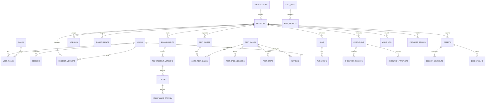

# TraceTest AI — Database Architecture & Schema Specification

TraceTest AI uses an ACID-compliant, self-contained relational storage architecture powered exclusively by **SQLite 3** running with **Write-Ahead Logging (WAL)**. No external database engines (PostgreSQL, MySQL, MongoDB, Redis) are required.

---

## 1. Storage Architecture Overview

### Database Files
1. **Primary Application Database (`var/tracetest.db`)**
   - Stores all application entities: organizations, users, projects, requirements, clauses, acceptance criteria, test cases, executions, defects, audit trails, and provider traces.
   - Initialized and managed through **Alembic** migrations located in `backend/migrations/`.
   - SQLite Pragmas enabled on every connection:
     ```sql
     PRAGMA journal_mode = WAL;
     PRAGMA foreign_keys = ON;
     PRAGMA busy_timeout = 10000;
     PRAGMA synchronous = NORMAL;
     ```
2. **LangGraph Checkpoint Database (`var/workflow_checkpoints.db`)**
   - Dedicated SQLite checkpoint database managed by `langgraph-checkpoint-sqlite` (`SqliteSaver`).
   - Stores serialized LangGraph execution states, allowing multi-step AI generation and execution pipelines to survive server restarts, support resume/replay, and maintain an immutable historical trace of graph transitions.
3. **Artifact Directory (`var/artifacts/`)**
   - Raw execution logs (`execution.log`), JUnit XML test summaries (`junit.xml`), failure screenshots (`failure-*.png`), and CSV/PDF reports.
   - SQLite stores relative paths, MIME types, file sizes, and SHA-256 integrity hashes in the `execution_artifacts` table.

---

## 2. Entity-Relationship Domains

The 36 tables in the primary schema are organized into 7 cohesive functional domains:



---

## 3. Schema Catalog by Domain

### 3.1 Identity, Access & Authentication
- **`organisations`**: Top-level tenant container (`id`, `name`, `slug`, `created_at`).
- **`users`**: Platform user accounts (`id`, `email`, `full_name`, `title`, `password_hash`, `is_active`, `can_login`, `created_at`, `last_login_at`). Passwords hashed using `argon2id`.
- **`roles`**: System roles (`admin`, `lead`, `author`, `reviewer`, `auditor`).
- **`user_roles`**: Many-to-many relationship mapping `user_id` to `role_id`.
- **`sessions`**: Server-side opaque session store (`id`, `user_id`, `session_token`, `expires_at`, `ip_address`, `user_agent`, `created_at`).
- **`login_attempts`**: Audit and rate-limiting log for authentication attempts (`id`, `email`, `ip`, `success`, `created_at`).

### 3.2 Workspace & Project Isolation
- **`projects`**: Tenant project workspace (`id`, `organisation_id`, `key`, `name`, `description`, `target_url`, `created_at`).
- **`project_members`**: RBAC project membership mapping (`id`, `project_id`, `user_id`, `role_id`). All API routes enforce project isolation against this table.
- **`modules`**: Subsystem categorization (`id`, `project_id`, `key`, `name`, `description`).
- **`environments`**: SUT deployment targets (`id`, `project_id`, `name`, `base_url`, `is_active`).

### 3.3 Requirements Engineering & Grounding
- **`requirements`**: High-level specification document (`id`, `project_id`, `key`, `title`, `source_filename`, `status`).
- **`requirement_versions`**: Document revision history (`id`, `requirement_id`, `version_number`, `raw_text`, `uploaded_by`, `created_at`).
- **`clauses`**: Deterministically parsed requirement clauses (`id`, `requirement_version_id`, `clause_number`, `text`, `ambiguity_score`, `detected_ambiguities`).
- **`acceptance_criteria`**: Derived criteria (`id`, `clause_id`, `key`, `text`, `grounding_score`, `is_negative_case`).

### 3.4 Test Repository & Versioning
- **`test_suites`**: Logical test collections (`id`, `project_id`, `name`, `description`, `created_by`).
- **`test_cases`**: Test specifications (`id`, `project_id`, `key`, `module_id`, `title`, `description`, `status`, `approval_status`, `script_hash`).
- **`test_case_versions`**: Historical script snapshots (`id`, `test_case_id`, `version_number`, `code`, `script_hash`, `created_by`, `created_at`).
- **`test_steps`**: Structured steps (`id`, `test_case_id`, `step_number`, `action`, `expected_result`).
- **`suite_test_cases`**: Association table linking `test_suites` and `test_cases`.

### 3.5 Governance, Approvals & Workflow Runs
- **`reviews`**: Dual-control approval requests (`id`, `test_case_id`, `requester_id`, `reviewer_id`, `status`, `comments`, `created_at`, `resolved_at`). Prohibits self-approval (`requester_id != reviewer_id`).
- **`runs`**: Asynchronous task orchestrations (`id`, `task_type`, `target_type`, `target_id`, `status`, `progress`, `triggered_by`, `started_at`, `finished_at`).
- **`run_steps`**: Granular progress transitions within a run (`id`, `run_id`, `step_name`, `status`, `message`, `created_at`).

### 3.6 Test Execution & Evidence Capture
- **`executions`**: Test execution instances (`id`, `project_id`, `suite_id`, `environment_id`, `triggered_by`, `status`, `started_at`, `finished_at`, `total_tests`, `passed_tests`, `failed_tests`).
- **`execution_results`**: Individual test case results (`id`, `execution_id`, `test_case_id`, `status`, `duration_ms`, `error_message`, `stack_trace`, `failure_type`).
- **`execution_artifacts`**: Captured runtime artifacts (`id`, `execution_id`, `test_case_id`, `artifact_type`, `file_path`, `file_size`, `sha256_hash`, `mime_type`).

### 3.7 Defects, Auditing & AI Observability
- **`defects`**: Quality issue tracking (`id`, `project_id`, `key`, `title`, `description`, `severity`, `status`, `created_by`, `assigned_to`, `verified_by`, `verified_at`).
- **`defect_comments`**: Threaded discussion on defects (`id`, `defect_id`, `user_id`, `comment`, `created_at`).
- **`defect_links`**: Traceability links between defects, test cases, executions, and requirements (`id`, `defect_id`, `target_type`, `target_id`).
- **`audit_log`**: Tamper-evident record of all user and system mutations (`id`, `project_id`, `user_id`, `action`, `resource_type`, `resource_id`, `details`, `ip_address`, `created_at`).
- **`provider_traces`**: LLM call telemetry (`id`, `provider`, `model`, `prompt_hash`, `latency_ms`, `input_tokens`, `output_tokens`, `repair_count`, `success`, `error_code`, `created_at`). Secrets and full keys are strictly omitted.
- **`eval_runs`**: 10-scenario golden evaluation benchmarks (`id`, `provider`, `model`, `is_fixture`, `status`, `metrics`, `scenario_count`, `triggered_by`, `started_at`, `finished_at`).
- **`eval_results`**: Detailed scenario scores within an eval run (`id`, `eval_run_id`, `scenario_key`, `clause_coverage`, `ungrounded_rate`, `duplicate_rate`, `schema_pass_rate`, `ambiguity_recall`, `traceability`, `passed`).
- **`ai_cache`**: Deterministic LLM response cache (`id`, `prompt_hash`, `task`, `provider`, `model`, `response`, `created_at`).
- **`integrations` & `integration_events`**: External webhook & issue-tracker sync states.
- **`notifications`**: User alert queue (`id`, `user_id`, `title`, `body`, `link`, `read`, `created_at`).

---

## 4. Alembic Migration Strategy

Database migrations are strictly version-controlled in `backend/migrations/versions/`.
- **Environment**: `backend/migrations/env.py` binds to SQLAlchemy `Base.metadata`.
- **Applying Migrations**:
  ```bash
  cd backend
  alembic upgrade head
  ```
- **Creating Migrations**:
  ```bash
  alembic revision --autogenerate -m "describe_change"
  ```
- **Automated Check**: All migrations are verified in CI/test pipelines via `test_migrations.py`.

---

## 5. Reference HCM Seed Catalog

The seed process (`backend/app/seed/seed.py`) establishes reference enterprise HCM projects:

| Project Key | Name | System Build | Test Cases | Seed Behavior |
|---|---|---|---|---|
| `HCM-1.0` | Global Enterprise HCM v1.0 | Fault-Injected Build | 100 | Contains 58 deliberate faults (payroll tax calculations, leave entitlement overflows, overtime limits). |
| `HCM-1.1` | Global Enterprise HCM v1.1 | Corrected Engine Build | 100 | Resolves 54 faults. 96 tests pass cleanly. Exactly 4 tests fail legitimately due to unsupported group differential rates (6%/12% and 7%/15%). |

### Standard Seed Personas
- **`admin@tracetest.local`** (Enterprise Admin): Full platform governance.
- **`lead@tracetest.local`** (QA Lead): Test suite management, approvals, runs.
- **`author@tracetest.local`** (Test Author): Requirements analysis, test generation, test editing.
- **`reviewer@tracetest.local`** (Senior Reviewer): Review queue triage, dual-control test approvals.
- **`auditor@tracetest.local`** (Compliance Auditor): Read-only traceability and audit log inspection.

---

## 6. Backup and Recovery Procedures

Because SQLite WAL mode decouples readers and writers, hot backups can be taken without locking the database:

```bash
# Hot online backup via SQLite VACUUM INTO
sqlite3 var/tracetest.db "VACUUM INTO 'var/backups/tracetest_$(date +%Y%m%d_%H%M%S).db';"

# Verify integrity of backup
sqlite3 var/backups/tracetest_*.db "PRAGMA integrity_check;"
```

