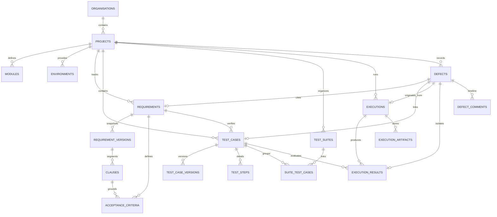

# Database Schema & Entity Relationships — TraceTest AI

## 1. Overview

TraceTest AI uses SQLite 3 operating with Write-Ahead Logging (`WAL`), immediate transaction locks, strict foreign key constraints, and 64-bit integer primary keys managed through SQLAlchemy 2.0 ORM.

---

## 2. Entity-Relationship Diagram



---

## 3. Core Tables Specification

### 3.1 `projects`
- `id` (INTEGER, PK): Unique project identifier.
- `key` (VARCHAR(10), UNIQUE): Short uppercase project key (e.g. `ECHO`, `DF-PAY`).
- `name` (VARCHAR(200)): Full project display name.
- `description` (TEXT): Architectural and operational scope description.
- `status` (VARCHAR(20)): `active` or `archived`.
- `organisation_id` (INTEGER, FK $\rightarrow$ `organisations.id`).
- `owner_id` (INTEGER, FK $\rightarrow$ `users.id`).

### 3.2 `modules`
- `id` (INTEGER, PK).
- `project_id` (INTEGER, FK $\rightarrow$ `projects.id`).
- `code` (VARCHAR(20)): Functional module code (e.g. `ECHO-ROOMS`, `ECHO-CHAT`).
- `name` (VARCHAR(200)): Module name.
- `description` (TEXT).

### 3.3 `environments`
- `id` (INTEGER, PK).
- `project_id` (INTEGER, FK $\rightarrow$ `projects.id`).
- `name` (VARCHAR(80)): Environment name.
- `kind` (VARCHAR(20)): `reference_hcm` or `web`.
- `base_url` (VARCHAR(500)): Base HTTP/HTTPS URL for web environments.
- `hcm_version` (VARCHAR(10)): `1.0` or `1.1` for reference HCM environments.
- `is_default` (BOOLEAN): Default environment flag.

### 3.4 `requirements` & `requirement_versions`
- `requirements`: Master requirement entry (`key`, `project_id`, `module_id`, `title`, `priority`, `status`, `current_version`).
- `requirement_versions`: Immutable version snapshots (`requirement_id`, `version`, `title`, `description`, `business_objective`, `content_hash`, `change_summary`).

### 3.5 `clauses` & `acceptance_criteria`
- `clauses`: Segmented atomic requirement statements (`clause_key`, `version_id`, `position`, `text`, `normalized_hash`, `ambiguity_flags`, `analysis`).
- `acceptance_criteria`: Grounded acceptance criteria (`key`, `requirement_id`, `clause_keys`, `description`, `source_quote`, `quote_verified`, `confidence`, `review_status`).

### 3.6 `test_cases`, `test_case_versions`, `test_steps`
- `test_cases`: Test definition (`key`, `requirement_id`, `clause_keys`, `ac_keys`, `title`, `test_type`, `automation`, `script`, `script_hash`, `validation_status`, `status`).
- `test_case_versions`: Immutable audit history of edited test scripts.
- `test_steps`: Ordered execution steps (`position`, `action`, `expected`).

### 3.7 `executions` & `execution_results`
- `executions`: Test suite run (`key`, `project_id`, `environment_id`, `source`, `runner`, `status`, `total`, `passed`, `failed`, `errored`, `duration_ms`, `log_excerpt`).
- `execution_results`: Per-test outcome (`execution_id`, `test_case_id`, `status`, `duration_ms`, `message`, `stack_trace`, `stdout`, `failure_analysis`).

### 3.8 `defects`
- `defects`: Discrepancy tracking ledger (`key`, `project_id`, `title`, `severity`, `priority`, `status`, `approval_status`, `requirement_id`, `test_case_id`, `execution_id`, `execution_result_id`, `expected_result`, `actual_result`, `reproduction_steps`, `error_log`, `ai_analysis`).

---

## 4. SQLite Pragmas & Concurrency Tuning

Applied on connection initialization (`app/db/base.py`):
```sql
PRAGMA foreign_keys = ON;
PRAGMA journal_mode = WAL;
PRAGMA synchronous = NORMAL;
PRAGMA busy_timeout = 10000;
```
Ensures zero lock contention during concurrent test executions and audit logging.
