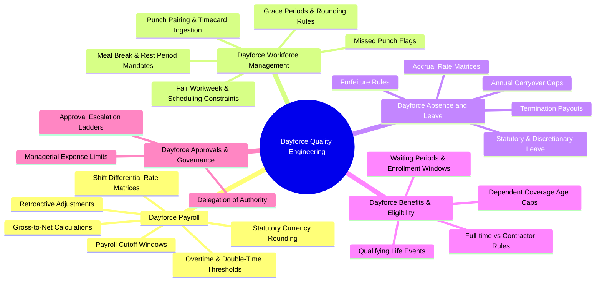

# TraceTest AI — Dayforce Domain & Quality Engineering Specification

## 1. Product Positioning & Non-Affiliation Notice

> [!IMPORTANT]
> **Independent Product Prototype Notice**
> TraceTest AI — Dayforce Edition is an independent enterprise quality engineering and requirement verification platform prototype. It is **not** developed, owned, sponsored, certified, or officially endorsed by Dayforce Inc. (formerly Ceridian HCM).
> 
> The platform does not claim access to Dayforce production environments, proprietary Dayforce APIs, or tenant databases. It is designed to assist enterprise quality engineering teams in analyzing, grounding, generating tests for, executing tests against authorized staging/test targets, and verifying business requirements related to Dayforce Human Capital Management (HCM) software implementations.

---

## 2. Dayforce HCM Domain Overview

Enterprise Dayforce implementations encompass mission-critical workflows across payroll, workforce management, time and attendance, scheduling, benefits, and absence management. TraceTest AI focuses on validating complex enterprise business rules across these core functional modules:

---

## 3. Verified Dayforce Terminology & Core Modules

All requirement specifications, test cases, and quality intelligence artifacts utilize authentic Dayforce enterprise terminology:

### 3.1 Dayforce Payroll
- **Gross-to-Net Calculations**: Verification of base hourly earnings, salary allocations, pre-tax/post-tax deduction sequences, and net disbursement amounts.
- **Statutory Rounding Rules**: Enforcing exact statutory currency rounding conventions (e.g. `ROUND_HALF_UP` statutory financial rounding vs banker's rounding) on penny calculations.
- **Overtime & Differential Rules**: Validation of FLSA 40-hour weekly thresholds, California 8-hour daily thresholds, seventh-day consecutive work rules, and multi-tier shift differentials (evening, night, weekend).
- **Payroll Cutoff Windows**: Boundary verification of timesheet submission cutoffs, manager approval deadlines, and lock periods for payroll processing cycles.

### 3.2 Dayforce Workforce Management (WFM) & Time and Attendance
- **Punch Pairing**: Pairing raw electronic timecard punches (In, Out, Transfer, Break Start, Break End) and identifying unpaired punches.
- **Meal Break Compliance**: Verification of mandatory meal break intervals (e.g., 30-minute uninterrupted meal break before the 5th hour of work) and automatic meal penalty premium calculations.
- **Scheduling & Rest Constraints**: Verification of minimum rest hours between consecutive shifts (e.g., "clopening" prevention rules with 11 hours minimum rest) and schedule change notice rules.

### 3.3 Dayforce Absence and Leave
- **Accrual Policies**: Calculating pay-period PTO accruals based on tenure tiers, hours worked, or fixed anniversary milestones.
- **Carryover & Rollover Caps**: Enforcing policy-specific caps on annual leave carry-forward balances and automatic forfeiture of excess balances on year-end boundary dates.
- **Termination Payouts**: Calculating statutory payouts of accrued, unused vacation upon employment separation according to state/jurisdictional mandates.

### 3.4 Dayforce Benefits & Eligibility
- **Eligibility Classes**: Classifying employees into benefit eligibility bands based on standard weekly hours (e.g. ≥ 30 hours for ACA medical coverage).
- **Exclusion Rules**: Enforcing policy exclusions for independent contractors (1099), seasonal employees, and temporary interns.

---

## 4. Requirement Verification Architecture

TraceTest AI enables quality engineers to take raw Dayforce functional specifications or Change Requests (CRs) through a deterministic verification lifecycle:

```mermaid
flowchart LR
    Req[Dayforce Requirement Doc] --> Parse[1. Clause Extraction & Numbering]
    Parse --> Ambiguity[2. Ambiguity & Conflict Analysis]
    Ambiguity --> Criteria[3. Grounded Acceptance Criteria]
    Criteria --> Scenarios[4. Positive, Negative & Boundary Tests]
    Scenarios --> Validation[5. Deterministic AST & Grounding Gate]
    Validation --> Review[6. Human Review & Dual-Control Approval]
    Review --> Execute[7. Sandboxed Execution vs SUT]
    Execute --> Triage[8. AI Root-Cause Failure Triage]
    Triage --> Retest[9. Fix Verification & Retest]
    Retest --> Matrix[10. Traceability & Compliance Ledger]
```

1. **Clause Numbering**: Atomic indexing of every functional clause (e.g. `CLAUSE-PAY-01`, `CLAUSE-WFM-04`).
2. **Ambiguity Detection**: Flagging vague language ("promptly", "reasonable calculations", "as appropriate") before tests are authored.
3. **Acceptance Criteria Grounding**: Every Given-When-Then criterion must quote and link back to its parent clause.
4. **Boundary & Negative Testing**: Mandatory generation of edge-case tests (e.g., exactly 40.0 hours, 40.1 hours, 39.9 hours, 17:00 cutoff boundary).
5. **Executable Test Cases**: Synthesizing deterministic Python test cases that interact with SUT interfaces or API endpoints.
6. **Retest Gate**: Defects can only transition to `Verified` when a genuine passing retest is executed against the corrected target environment.
