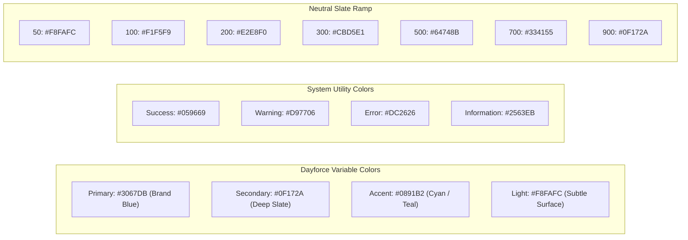

# TraceTest AI — Dayforce Visual Design System

## 1. Design Philosophy & Foundations

The TraceTest AI Dayforce Quality Engineering visual design system marries **Dayforce's enterprise HCM theme configuration model** with modern enterprise SaaS interaction craft (Linear-grade responsiveness, Vercel-grade clarity, Stripe-grade data density, and GitHub-grade workflow ergonomics).

### Core Principles
- **Clarity over Decoration**: Restrained, purposeful surfaces with zero decorative gradients, floating cards, or artificial neon glows.
- **High-Density Data Presentation**: Optimized for technical quality engineers and compliance auditors who require dense, tabular, and comparative data.
- **Light-First Architecture**: Clean white and soft slate backgrounds with high contrast ratios exceeding WCAG AA requirements (≥ 4.5:1).
- **Physical Interaction Feedback**: Sub-200ms transitions, instant 0ms keyboard `:focus-visible` rings, and comprehensive `@media (prefers-reduced-motion: reduce)` fallbacks.

---

## 2. Color System & Theme Configuration Model

Conforming to the Dayforce enterprise branding variable tiers:



### 2.1 CSS Custom Properties (`frontend/src/index.css`)
```css
:root {
  /* Dayforce Variable Colors */
  --df-primary: #3067DB;
  --df-primary-hover: #2554B8;
  --df-primary-light: #EFF6FF;
  --df-secondary: #0F172A;
  --df-secondary-light: #F8FAFC;
  --df-accent: #0891B2;
  --df-accent-light: #ECFEFF;
  --df-light: #F8FAFC;

  /* Surfaces & Borders */
  --df-bg-app: #F8FAFC;
  --df-surface: #FFFFFF;
  --df-border: #E2E8F0;
  --df-border-subtle: #F1F5F9;
  --df-border-focus: #3067DB;

  /* Typography */
  --df-text-primary: #0F172A;
  --df-text-secondary: #475569;
  --df-text-muted: #64748B;
  --df-text-inverse: #FFFFFF;

  /* Utility Semantics */
  --df-success: #059669;
  --df-success-bg: #ECFDF5;
  --df-success-border: #A7F3D0;
  --df-warning: #D97706;
  --df-warning-bg: #FFFBEB;
  --df-warning-border: #FDE68A;
  --df-error: #DC2626;
  --df-error-bg: #FEF2F2;
  --df-error-border: #FECACA;
  --df-info: #2563EB;
  --df-info-bg: #EFF6FF;
  --df-info-border: #BFDBFE;
}
```

---

## 3. Typography Hierarchy

### Font Family
- **Primary**: `Google Sans`, system fonts, sans-serif.
- **Fallback**: `Tahoma`, `Arial`, sans-serif.
- **Monospace**: `JetBrains Mono`, `Fira Code`, `ui-monospace`, monospace (for test scripts, hashes, AST dumps).

### Type Scale
| Role | Font Size | Line Height | Font Weight | Usage |
|---|---|---|---|---|
| **Page Title** | 24px (1.5rem) | 32px | 600 (Semibold) | Screen headers, dashboard title |
| **Section Title** | 18px (1.125rem) | 24px | 600 (Semibold) | Card titles, drawer headers, modal titles |
| **Subsection Header** | 15px (0.9375rem) | 20px | 600 (Semibold) | Table headers, accordion section titles |
| **Body Text** | 14px (0.875rem) | 20px | 400 (Regular) | General prose, descriptions, form inputs |
| **Table Data** | 13px (0.8125rem) | 18px | 400 / 500 | Dense table cells, list items |
| **Metadata & Badges**| 12px (0.75rem) | 16px | 500 (Medium) | Timestamps, tags, clause numbers, status badges |
| **Code & Script** | 12px (0.75rem) | 18px | 400 (Mono) | Python test steps, stack traces, hashes |

---

## 4. Spacing, Elevation & Corner Radii

### 4.1 Spacing Scale (4px / 8px Grid)
- `space-1`: 4px — Tight badge padding, icon gap.
- `space-2`: 8px — Button inner horizontal padding, cell gaps.
- `space-3`: 12px — Input padding, list item vertical padding.
- `space-4`: 16px — Standard card internal padding, form group gap.
- `space-6`: 24px — Section spacing, grid gutters.
- `space-8`: 32px — Screen-level vertical margins.

### 4.2 Corner Radii
- `rounded-sm`: 4px — Badges, tag pills, small inputs.
- `rounded`: 6px — Buttons, text fields, dropdown menus.
- `rounded-md`: 8px — Cards, table containers, modal dialogs.
- `rounded-lg`: 12px — Floating drawers, main workspace containers.

### 4.3 Elevation & Shadows
Enterprise applications avoid heavy drop shadows in favor of crisp, structural borders:
- **Default Surface**: `border border-slate-200 bg-white` with `shadow-[0_1px_2px_rgba(0,0,0,0.04)]`.
- **Active Card / Hover**: `border-slate-300 shadow-[0_2px_4px_rgba(0,0,0,0.06)]`.
- **Dropdowns & Popovers**: `border border-slate-200 bg-white shadow-[0_4px_12px_rgba(0,0,0,0.08)]`.
- **Modals & Drawers**: `border border-slate-200 bg-white shadow-[0_12px_32px_rgba(0,0,0,0.12)]`.

---

## 5. Interaction & Animation Standards

Following `emil-design-eng` motion vocabulary:

| Interaction Event | Target Property | Duration | Easing Curve |
|---|---|---|---|
| **Button Click / Press** | `transform` (scale 0.99) | 100ms | `ease-out` |
| **Hover State** | `background-color`, `border-color` | 140ms | `cubic-bezier(0.16, 1, 0.3, 1)` |
| **Dropdown / Menu Open** | `opacity`, `transform` (y: -4px → 0) | 160ms | `cubic-bezier(0.16, 1, 0.3, 1)` |
| **Drawer Slide-Over** | `transform` (translateX) | 220ms | `cubic-bezier(0.32, 0.72, 0, 1)` |
| **Modal Scale-In** | `opacity`, `transform` (scale 0.98 → 1) | 180ms | `cubic-bezier(0.16, 1, 0.3, 1)` |
| **Keyboard Focus Ring** | `box-shadow` (`ring-2 ring-blue-600`) | **0ms (Instant)**| Instantaneous for accessibility |

### Reduced Motion Override
```css
@media (prefers-reduced-motion: reduce) {
  *, *::before, *::after {
    animation-duration: 0.01ms !important;
    animation-iteration-count: 1 !important;
    transition-duration: 0.01ms !important;
    scroll-behavior: auto !important;
  }
}
```

---

## 6. Component Specs

### 6.1 Status Badge Tokens
- **Approved / Passed / Verified**: Green surface (`bg-emerald-50 text-emerald-700 border-emerald-200`).
- **Failed / Defect / Error**: Red surface (`bg-rose-50 text-rose-700 border-rose-200`).
- **Running / Evaluating / In Progress**: Blue surface (`bg-blue-50 text-blue-700 border-blue-200`) with subtle pulsing indicator.
- **Pending Review / Triaged**: Amber surface (`bg-amber-50 text-amber-700 border-amber-200`).
- **Draft / Inactive / Skipped**: Slate surface (`bg-slate-100 text-slate-600 border-slate-200`).

### 6.2 Button Hierarchy
- **Primary Button**: `bg-[#3067DB] hover:bg-[#2554B8] text-white font-medium px-3.5 py-1.5 rounded text-sm shadow-xs transition-colors`.
- **Secondary Button**: `bg-white hover:bg-slate-50 text-slate-700 border border-slate-300 font-medium px-3.5 py-1.5 rounded text-sm shadow-xs transition-colors`.
- **Ghost Button**: `hover:bg-slate-100 text-slate-600 hover:text-slate-900 font-medium px-2.5 py-1.5 rounded text-sm transition-colors`.
- **Destructive Button**: `bg-rose-600 hover:bg-rose-700 text-white font-medium px-3.5 py-1.5 rounded text-sm shadow-xs transition-colors`.

