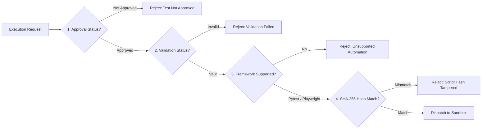

# TraceTest AI — Sandboxed Test Execution Engine

The TraceTest AI execution engine provides safe, isolated, and deterministic execution of user-submitted and AI-generated Python test scripts. It ensures that untrusted test code cannot inspect host secrets, exhaust server resources, or compromise application integrity.

---

## 1. Pre-Execution Governance & Integrity Gates

Before any test script can be scheduled or dispatched to the sandbox, it must satisfy four mandatory deterministic gates:



1. **Dual-Control Approval**: The test case status must be `approved` by an authorized reviewer distinct from the test author.
2. **Schema & AST Validation**: The test script must have passed deterministic syntax and structure validation (`validation_status == 'valid'`).
3. **Supported Automation Framework**: The automation type must be either `pytest` (API/Unit/Integration) or `playwright` (End-to-End Browser).
4. **Cryptographic Integrity Hash**: The SHA-256 hash of the exact Python code string stored in the database must match the `script_hash` computed at approval time. Any edit to a test script generates a new version, resets its approval state to `pending_review`, and recalculates the hash.

---

## 2. Multi-Layer Sandbox Architecture

The sandbox (`backend/app/execution/sandbox.py`) wraps test execution in multiple layers of defense:

```mermaid
flowchart TD
    Script[Approved Python Script] --> Layer1[Layer 1: AST Allowlist & Forbidden Dunder Check]
    Layer1 -->|Disallowed Syntax| ErrAST[Execution Error: Disallowed Syntax]
    Layer1 -->|Clean AST| Layer2[Layer 2: Clean Isolated Workspace]
    Layer2 --> Layer3[Layer 3: Environment Scrubbing]
    Layer3 --> Layer4[Layer 4: Socket & DNS Monkeypatch Guard]
    Layer4 --> Layer5[Layer 5: POSIX Resource Caps (RLIMIT)]
    Layer5 --> Layer6[Layer 6: Linux Network Namespace (unshare -rn)]
    Layer6 --> Layer7[Layer 7: Wall-Clock Supervision & SIGKILL]
    Layer7 --> Layer8[Layer 8: Artifact Capture & SHA-256 Digest]
```

### Layer 1: AST Allowlist Inspection
Before execution, the code is parsed into Python AST nodes (`ast.parse`):
- **Allowed Modules**: `pytest`, `unittest`, standard data types (`math`, `json`, `datetime`, `re`, `decimal`), and SUT client libraries (`reference_hcm.*`).
- **Disallowed Modules**: `os`, `sys`, `subprocess`, `shutil`, `socket`, `importlib`, `ctypes`, `builtins`, `pty`.
- **Disallowed Constructs**: `eval()`, `exec()`, `__import__()`, arbitrary attribute access (`getattr`, `setattr`), dunder traversal (`__class__`, `__subclasses__`), global modifications, `while` loops (preventing busy-spin CPU locks), and asynchronous coroutines outside supported fixtures.

### Layer 2: Clean Workspace Isolation
A fresh temporary directory is created for every execution run (`tempfile.mkdtemp`):
- Test scripts and reference libraries are staged into this isolated directory.
- `HOME` is set to the temporary directory.
- Python is executed in isolated mode (`python -I -B -m pytest ...`), disabling site-packages user directories and bytecode caching (`__pycache__`).

### Layer 3: Environment Scrubbing
The child subprocess receives an explicitly allowlisted dictionary of environment variables:
- **Allowed**: `PATH`, `LANG`, `HOME`, `PYTHONHASHSEED`, `PYTHONDONTWRITEBYTECODE`, and SUT targets (`REFERENCE_HCM_VERSION`).
- **Blocked**: Server credentials (`GROQ_*`, `GEMINI_*`, `TRACETEST_SECRET_KEY`, database paths, and API tokens) are strictly omitted.

### Layer 4: Socket & DNS Guard
A guard `conftest.py` is injected into the root of the temporary execution workspace:
- Monkeypatches Python's standard `socket` module to raise `PermissionError` on all attempted network connections (`socket.socket`, `socket.create_connection`, `socket.getaddrinfo`).
- Prevents data exfiltration or external SSRF calls during unit/API test runs.

### Layer 5: POSIX Resource Limits (`resource.setrlimit`)
Resource limits are applied inside the child process before executing the test command:
- **Virtual Memory (`RLIMIT_AS`)**: Hard limit (default: 512 MiB, configurable via `TRACETEST_EXEC_MEMORY_MB`).
- **CPU Time (`RLIMIT_CPU`)**: Maximum CPU computation seconds.
- **Open File Descriptors (`RLIMIT_NOFILE`)**: Capped at 256.
- **File Output Size (`RLIMIT_FSIZE`)**: Capped at 50 MiB to prevent disk space exhaustion.
- **Process Spawning (`RLIMIT_NPROC`)**: Prohibits forking sub-processes.
- **Core Dumps (`RLIMIT_CORE`)**: Set to 0 to prevent memory dumps containing sensitive traces.

### Layer 6: Linux Network Namespace Isolation
On Linux hosts supporting unprivileged user namespaces, the sandbox spawns the process under `unshare -rn`:
- Runs in a clean, detached network namespace with only a loopback interface (`lo`).
- The execution's audit trail records whether Linux namespace isolation was applied (`network_isolated: true`).

### Layer 7: Wall-Clock Supervision & Process Group Termination
- Each execution is executed within a dedicated process group (`os.setsid`).
- Supervised by a hard wall-clock timeout (`TRACETEST_EXEC_TIMEOUT`, default: 60s).
- On timeout, the entire process group is terminated using `SIGKILL` to prevent orphan child processes.
- Process stdout/stderr output is captured and capped at `TRACETEST_EXEC_MAX_OUTPUT` (default: 5 MiB).

### Layer 8: Artifact Capture & Cryptographic Fingerprinting
Upon completion, the engine parses execution outputs and persists all generated files to `var/artifacts/`:
- **JUnit XML (`junit.xml`)**: Parsed to extract test durations, failure messages, and stack traces.
- **Execution Log (`execution.log`)**: Full console output.
- **Screenshots (`failure-*.png`)**: Captured during UI test failures.
- Every artifact record in `execution_artifacts` stores the relative file path, byte size, MIME type, and SHA-256 checksum.

---

## 3. Playwright End-to-End Browser Testing

For web application testing (`automation == 'playwright'`):
- **Target Environments**: Configured with a `base_url` pointing to the target web application.
- **Fixture Injection**: Playwright scripts receive managed `page` and `base_url` fixtures.
- **Browser Executable**: Configurable via `TRACETEST_CHROMIUM_EXECUTABLE` (e.g. `/usr/bin/chromium` or Playwright bundled browsers).
- **Network & Memory Adaptation**: Browser processes require network access to the target host and allocate large virtual address spaces; `RLIMIT_AS` is lifted while maintaining strict CPU, file size, and timeout limits.
- **Trace & Screenshot Artifacts**: Automatically records browser console messages, network errors, and full-page viewport screenshots on assertion failures.

---

## 4. Asynchronous Task Worker & SSE Streaming

1. **In-Process Task Queue**: Long-running test executions run on a background thread pool managed by `backend/app/services/tasks.py`.
2. **Progress Monitoring**: Execution progress is updated in real time in the `runs` and `run_steps` tables (`status`, `progress` 0-100%).
3. **Server-Sent Events (SSE)**: Clients connect to `GET /api/v1/runs/{id}/events` for live real-time progress events. The frontend automatically falls back to HTTP polling if SSE is interrupted.

---

## 5. CI/CD Pipeline Integration & Comparison API

The platform exposes endpoints for automated external CI/CD pipelines:
- **Result Ingestion**: External runners post JUnit XML results to `POST /api/v1/ci/results`, recording the execution with `source = 'ci'`, Git commit hash, and branch name.
- **Regression Comparison**: `GET /api/v1/executions-compare?a={id_1}&b={id_2}` computes a side-by-side diff of test statuses, identifying newly broken tests, resolved defects, and execution latency regressions.

