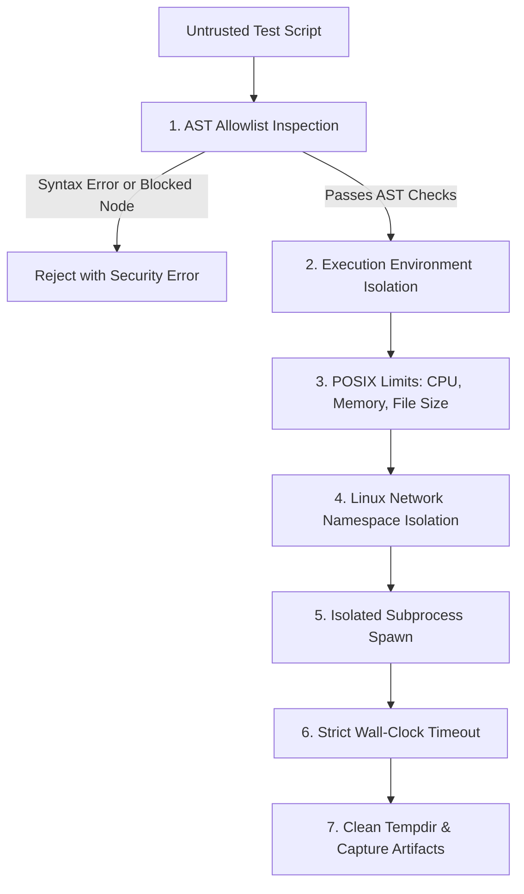

# TraceTest AI — Enterprise Security Specification

## 1. Executive Summary & Security Posture

TraceTest AI is designed for enterprise environments where requirements, test cases, execution artifacts, and source specifications contain sensitive intellectual property. The platform enforces a **Defense-in-Depth** security posture across seven distinct tiers:

1. **Authentication & Session Security**: Memory-hard password hashing, cryptographically random sessions, and strict CSRF protection.
2. **Access Control & Dual-Control Governance**: Enforced Role-Based Access Control (RBAC) and mandatory separation of duties (Four-Eyes Principle).
3. **Project & Tenant Isolation**: Strict database-level isolation preventing cross-tenant leakage.
4. **Sandboxed Code Execution**: Multi-layered Python execution engine with AST inspection, POSIX resource limits, and network isolation.
5. **AI Safety & Prompt Injection Mitigation**: Delimited prompt structure, injection heuristics, and strictly deterministic output validation.
6. **Credential & Secret Protection**: Zero hardcoded secrets, multi-credential pooling, in-memory rotation, and non-sensitive diagnostic telemetry.
7. **Audit & Forensics**: Immutable, structured audit trails and end-to-end distributed trace tracking.

---

## 2. Authentication & Credential Architecture

### 2.1 Password Hashing (Argon2id)
All user passwords are encrypted using **Argon2id** (via `argon2-cffi`), the winner of the Password Hashing Competition (PHC) and recommended by NIST SP 800-63B.
- Default configuration: `time_cost=3`, `memory_cost=65536` (64 MiB), `parallelism=4`.
- Seed/system accounts without an explicitly provided environment variable cannot authenticate.

### 2.2 Server-Side Session Management
- **Token Generation**: 256-bit entropy using Python's `secrets.token_urlsafe(32)`.
- **Database Storage**: The raw token is **never** stored in the database. Only the `HMAC-SHA256(token, TRACETEST_SECRET_KEY)` digest is persisted in the `sessions` table, preventing token reuse even in the event of an offline database compromise.
- **Cookie Flags**:
  - `HttpOnly`: Strictly prevents JavaScript and XSS access.
  - `SameSite=Lax`: Prevents CSRF on cross-origin navigation.
  - `Secure`: Enabled via `TRACETEST_COOKIE_SECURE=true` in production/TLS environments.
  - Expiry: Configurable session timeout (default: 8 hours). Immediate server-side invalidation upon logout.

### 2.3 CSRF Defense
- TraceTest AI enforces double-submit token validation.
- A unique, cryptographically generated CSRF token is issued per session.
- Returned as a readable cookie and returned in authentication payloads.
- All state-mutating HTTP methods (`POST`, `PUT`, `DELETE`, `PATCH`) require the matching token in the `X-CSRF-Token` header.
- Verification is performed using constant-time string comparison (`hmac.compare_digest`).

### 2.4 Login Throttling & Account Lockout
- Failed login attempts are recorded with timestamp, email, and client IP in the `login_attempts` table.
- An account is throttled if 5 failed attempts occur within a 15-minute window (HTTP 429 Too Many Requests).
- Global per-IP rate limiting: 60 requests per minute on authentication endpoints.

---

## 3. Role-Based Access Control (RBAC) & Governance

### 3.1 Role Hierarchy
| Role | Permissions & Responsibilities |
|---|---|
| **Admin** | System configuration, user provisioning, project creation, organization governance. |
| **QA Lead** | Project management, environment configuration, test suite orchestration, defect escalation. |
| **Test Author** | Requirements upload, AI test generation, manual test drafting, test editing. |
| **Reviewer** | Review queue triage, dual-control approval/rejection, defect verification. |
| **Auditor** | Read-only access to requirements, test cases, executions, audit logs, and compliance matrices. |

### 3.2 Dual-Control Governance (Four-Eyes Principle)
To prevent accidental or malicious test tampering in compliance-regulated environments:
- **No Self-Approval**: A user who created or last modified a test case is strictly prohibited from approving their own review request.
- **Enforcement Level**: Backend service and database query validation. The API returns `403 Forbidden` if `requester_id == reviewer_id`.
- **Execution Gate**: Only test cases with `approval_status == 'approved'` and matching `script_hash` can be scheduled for automated execution.

---

## 4. Multi-Tenant Project Isolation

Every resource in TraceTest AI belongs to a specific `project_id`.
1. **Query-Level Scoping**: All database queries executed by non-admin users join `project_members` to verify that the requesting user has active membership in the target project.
2. **Uniform 404 Response**: Requests for resources outside the user's authorized projects return `404 Not Found` rather than `403 Forbidden`, preventing resource enumeration attacks.
3. **No Cross-Project Leaks**: Requirements, test cases, executions, and defects are strictly isolated. Test suites cannot cross project boundaries.

---

## 5. Sandboxed Test Execution Engine

Test scripts executed by the platform are untrusted Python code. The engine enforces defense-in-depth:

1. **AST Allowlist Inspection**:
   - The script is parsed into an Abstract Syntax Tree before execution.
   - Banned imports: `os`, `sys`, `subprocess`, `shutil`, `socket`, `pty`, `eval`, `exec`, `__import__`, `ctypes`.
   - Allowed imports: strictly limited to authorized SUT clients, testing utilities, `math`, `json`, `datetime`.
2. **POSIX Resource Limits (`resource.setrlimit`)**:
   - `RLIMIT_CPU`: Hard cap on CPU seconds (preventing infinite computation).
   - `RLIMIT_AS` (Virtual Memory): Max memory allocation (default: 512 MiB).
   - `RLIMIT_FSIZE`: Max file size output (preventing disk exhaustion).
   - `RLIMIT_NPROC`: Prohibits forking sub-processes.
3. **Network Namespace Isolation**:
   - Where supported by the Linux kernel, processes are spawned in an isolated unshared network namespace (`CLONE_NEWNET`), preventing unauthorized outbound network requests.
4. **Wall-Clock Timeout**:
   - Every execution is bounded by a hard supervisor timeout (default: 30 seconds). Subprocesses that do not terminate within the deadline are terminated with `SIGKILL`.

---

## 6. AI Safety & Prompt Injection Mitigation

1. **Boundary Delimitation**:
   - User-supplied requirement specifications and text uploads are treated as untrusted data.
   - Requirement texts are wrapped in explicit boundary delimiters (e.g. `<user_requirement>...</user_requirement>`) with system instructions forbidding directive parsing from within the payload.
2. **Injection Marker Detection**:
   - Incoming requirement payloads are pre-scanned for common adversarial patterns (`"ignore previous instructions"`, `"system override"`, `"system prompt"`, `"as an AI"`).
   - Detections trigger warning flags in the audit trail without silently crashing the workflow.
3. **Deterministic Guardrails**:
   - The LLM is **never** trusted to make authorization decisions, approve tests, set execution hashes, or verify defects.
   - All AI output schemas are validated against strict Pydantic definitions.
   - Test cases generated by AI must undergo deterministic acceptance criteria grounding and human dual-control review before they can execute.

---

## 7. Credential & Secret Management

- **Storage**: API credentials (`GROQ_API_KEY*`, `GEMINI_API_KEY*`, `TRACETEST_SECRET_KEY`) reside exclusively in local environment files (`.env`).
- **Git Hygiene**: `.gitignore` strictly blocks all `.env*` files (except the safe placeholder `.env.example`), SQLite databases (`*.db*`), and execution artifacts (`artifacts/*`).
- **Telemetry Redaction**:
  - The health check endpoint `/api/config` and `/api/health` reports provider availability status (`ok`, `rate_limited`, `unconfigured`) and non-sensitive slot counts.
  - Raw API keys, partial keys, and key substrings are strictly sanitized and never emitted in HTTP responses, application logs, or audit events.

---

## 8. HTTP Security Headers & Audit Logging

### 8.1 Default Security Headers
Every HTTP response emitted by the FastAPI application includes:
- `X-Content-Type-Options: nosniff`
- `X-Frame-Options: DENY`
- `Referrer-Policy: same-origin`
- `X-Trace-Id`: Unique UUID4 per request for end-to-end request tracing.

### 8.2 Tamper-Evident Audit Logging
Every state mutation (test creation, review submission, approval, execution trigger, defect status change, configuration update) writes an immutable record to the `audit_log` table containing:
- `user_id` and originating `ip_address`.
- `project_id`, `resource_type`, and `resource_id`.
- `action` (`CREATE`, `UPDATE`, `DELETE`, `APPROVE`, `EXECUTE`).
- Structured JSON snapshot of mutated attributes.
