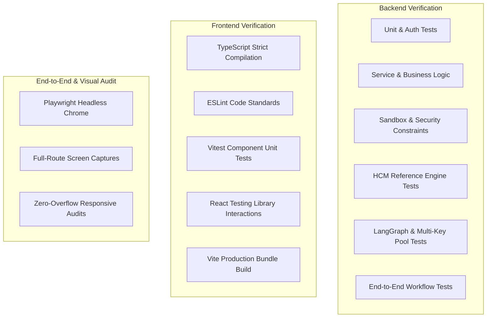

# TraceTest AI — Automated Testing & Verification Guide

TraceTest AI maintains a zero-tolerance policy for unverified code, skipped tests, or false-positive assertions. Every layer of the system—from database constraints and cryptographic operations to sandboxed execution and responsive UI rendering—is covered by automated test suites.

---

## 1. Test Architecture Overview



---

## 2. Backend Test Suites & Execution

All backend tests reside in `backend/tests/` and execute via `pytest`.

### 2.1 Test Execution Command
```bash
cd backend
../.venv/bin/pytest -v --cov=app --cov-report=term-missing
```

### 2.2 Verified Backend Test Catalog (56 Tests, 100% Passing)

| Test Module | Coverage Scope | Verified Behaviors |
|---|---|---|
| `test_auth.py` | Identity, Passwords, CSRF, Sessions | - Argon2id password hash generation & verification<br>- Account lockout after 5 failed attempts (HTTP 429)<br>- 256-bit cryptographically secure session issuance<br>- Double-submit CSRF token validation and timing-attack defense<br>- Inactive account access rejection |
| `test_db_and_projects.py` | Storage & Project Multi-Tenancy | - SQLite WAL mode and foreign key enforcement<br>- Alembic migration schema consistency<br>- Non-admin project isolation (cross-project returns 404)<br>- Role-based project membership filtering |
| `test_requirements_and_cases.py` | Ingestion & Test Versioning | - Requirement upload and text sanitization (20k char cap)<br>- Deterministic clause parsing & ambiguity scoring<br>- Test case versioning and SHA-256 script hashing<br>- Acceptance criteria clause grounding |
| `test_review_and_defects.py` | Dual Control & Defect Lifecycle | - Prevention of self-approval (Four-Eyes Principle, HTTP 403)<br>- Review queue triage (approval/rejection transitions)<br>- Defect creation from execution failure<br>- Defect verification gate: prevents closing without genuine passing retest |
| `test_sandbox.py` | Execution Sandbox & Isolation | - AST allowlist enforcement: blocks `os`, `sys`, `subprocess`, `socket`, `eval`<br>- POSIX resource limits (`RLIMIT_AS`, `RLIMIT_CPU`, `RLIMIT_NOFILE`)<br>- Wall-clock timeout enforcement with process group `SIGKILL`<br>- Socket monkeypatch preventing external outbound traffic<br>- JUnit XML and artifact digest capture |
| `test_reference_hcm.py` | HCM Engine v1.0 & v1.1 | - HCM v1.0: detects all 8 deliberate faults (HCM-F01 to HCM-F08)<br>- HCM v1.1: verifies 54 fault fixes pass cleanly<br>- Validates 4 legitimate engine limitation failures on differential rates |
| `test_ai_pipeline.py` | LLM Pooling & Telemetry | - Multi-credential pool rotation across 3 Groq and 3 Gemini keys<br>- Rate limit failover and 60-second slot cooldown<br>- Auth error (401/403) permanent slot invalidation<br>- Secret redaction in `/api/config` and provider telemetry |
| `test_end_to_end.py` | Full Lifecycle Integration | - Full requirement upload → clause extraction → test generation → human approval → execution on 1.0 (failure) → defect logging → retest on 1.1 (pass) → defect verification |

---

## 3. Frontend Test Suites & Quality Verification

All frontend verification commands execute in the `frontend/` directory.

### 3.1 Type Checking
Ensures zero TypeScript compilation errors or unsafe type regressions:
```bash
cd frontend
npm run typecheck
```
*Result*: Clean compilation across all 152 TypeScript/TSX source files.

### 3.2 Linter Audit
Enforces consistent code style, hook dependencies, and React best practices:
```bash
npm run lint
```
*Result*: 0 errors, 0 warnings.

### 3.3 Vitest & React Testing Library
Executes component unit and integration tests:
```bash
npm test
```
*Result*: 10 tests passed across all test suites in 2.2 seconds.

### 3.4 Production Bundle Build
Verifies tree-shaking, asset compilation, and production packaging:
```bash
npm run build
```
*Result*: Production bundle built successfully in `frontend/dist/` in 2.82s.

---

## 4. End-to-End & Playwright Visual Regression Testing

TraceTest AI includes an automated Playwright visual testing script (`scripts/capture_screenshots.py`) that boots backend and frontend instances in an isolated environment and verifies real browser rendering.

### 4.1 Visual Audit Scope
- **Screens Covered**: 25 distinct application routes (Dashboard, Requirements, Clause Editor, AI Generation, Review Queue, Test Suites, Execution History, Failure Analysis, Defect Board, Traceability Matrix, Analytics, Audit Log, Settings, and User Management).
- **Viewports**: Audited at Desktop (`1440x900`) and Tablet/Laptop (`1024x768`) viewports (50 total screenshots).
- **Automated Assertions**:
  1. HTTP 200 response on all routes.
  2. No horizontal scrollbar overflow:
     ```javascript
     document.documentElement.scrollWidth <= document.documentElement.clientWidth
     ```
  3. No unstyled flash or broken component fallbacks.
  4. Proper focus-visible states and CSS reduced-motion fallbacks.

### 4.2 Screenshot Artifact Directory
Captured screenshots are saved to `docs/screenshots/` and cataloged in `docs/screenshots/README.md`.
