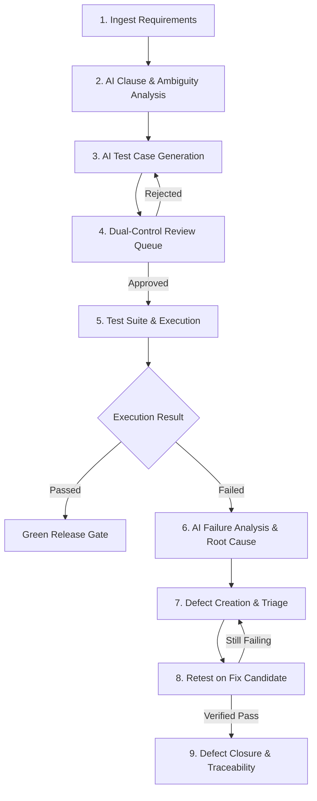

# TraceTest AI — Enterprise User & Operator Guide

Welcome to **TraceTest AI**, the enterprise-grade AI-powered quality assurance and test engineering platform. This guide provides a complete operational walkthrough for test authors, QA leads, reviewers, and compliance auditors.

---

## 1. Platform Overview & User Roles

TraceTest AI supports 5 distinct role personas:
- **Admin**: System configuration, user provisioning, global organization management.
- **QA Lead**: Project workspace management, test suite orchestration, defect triage.
- **Test Author**: Ingests requirements, triggers AI test generation, drafts and edits test cases.
- **Reviewer**: Evaluates generated test cases in the Review Queue, approves or rejects scripts under dual-control governance.
- **Auditor**: Inspects requirement-to-defect traceability matrices, audit logs, and compliance records.

---

## 2. Operational Workflow Walkthrough

---

## 3. Step-by-Step Instructions

### Step 1: Authentication & Workspace Selection
1. Navigate to the platform login page.
2. Sign in with your assigned organizational credentials (e.g., `author@tracetest.local` or `lead@tracetest.local`).
3. Select your active project workspace from the top-navigation dropdown (e.g., **Global Enterprise HCM v1.0**).
4. All requirements, suites, test runs, and defects are strictly scoped to the active project workspace.

### Step 2: Requirement Ingestion & Versioning
1. Navigate to **Requirements** from the sidebar.
2. Click **New Requirement** to open the ingestion dialog.
3. Provide a requirement key (e.g. `REQ-PAY-01`), title, and either paste specification text or upload a `.txt`, `.md`, or `.pdf` file.
4. Click **Create Requirement**.
5. *Revision Tracking*: Any subsequent edit creates an immutable new version (`v1`, `v2`, etc.), preserving full historical diffs.

### Step 3: AI Analysis & Test Case Generation
1. In the requirement details view, navigate to the **AI Generation** tab.
2. Click **Run Analysis & Generation**.
3. The platform executes the LangGraph workflow:
   - **Clause Extraction**: Atomically segments the document into numbered clauses.
   - **Ambiguity Detection**: Highlights underspecified criteria (e.g., "timely manner", "reasonable calculation") and computes an ambiguity risk score.
   - **Acceptance Criteria**: Formulates Given-When-Then criteria mapped directly to clauses.
   - **Test Generation**: Synthesizes executable Python test cases complete with concrete test steps.
4. Upon generation, all tests enter the `pending_review` state.

### Step 4: Dual-Control Review Queue (Governance)
1. Log in as a user with the **Reviewer** role (e.g. `reviewer@tracetest.local`).
   > [!IMPORTANT]
   > The platform strictly enforces the Four-Eyes Principle. Test authors **cannot** approve their own test cases.
2. Navigate to the **Review Queue**.
3. Click on a pending test case to inspect its title, description, clause grounding references, and generated Python code.
4. Click **Approve** to authorize the test case for automated execution, or **Reject** with feedback.
5. Approval calculates and locks the cryptographic SHA-256 `script_hash`.

### Step 5: Test Suite Organization & Execution
1. Navigate to **Test Suites** and create a logical grouping (e.g., `Payroll Core Regression Suite`).
2. Add approved test cases to the suite.
3. Click **Run Suite**:
   - Choose the target environment: **QA — Reference HCM 1.0** (standard testbed) or **Candidate — Reference HCM 1.1** (patched build).
   - Click **Execute**.
4. The execution runs inside the isolated POSIX/Linux namespace sandbox. Monitor real-time status and progress percentage via the live Server-Sent Events stream.

### Step 6: Failure Triage & Root Cause Analysis
1. Navigate to **Executions** and click on a completed execution run.
2. Inspect the summary metrics (Total, Passed, Failed, Duration).
3. Click on any failed test case to open the **Failure Analysis Drawer**:
   - **Error Details**: Full stack trace and failure message.
   - **AI Classification**: Categorized automatically (e.g., `application_defect` vs `flaky_test`).
   - **Root Cause & Diff**: Identifies exact assertion failure (e.g. `Expected 40.0, Received 41.0`).
   - **Artifacts**: Download captured console logs, JUnit XML, and failure screenshots.
4. Click **Create Defect** to automatically open a defect pre-populated with reproduction steps and execution trace links.

### Step 7: Fix Candidate Retesting & Defect Verification
1. When a new system build is deployed to the **Candidate — Reference HCM 1.1** environment:
2. Open the open defect in the **Defect Board**.
3. Click **Retest Defect**:
   - The platform re-runs the specific linked test case against the candidate environment.
4. If the test passes on the candidate build:
   - The defect automatically transitions to `verified`.
   - The reviewer can now click **Close Defect**.
   > [!NOTE]
   > If the retest fails (as with unsupported differential rates), the defect remains `open` and cannot be falsely closed.

### Step 8: Traceability Matrix & Compliance Export
1. Navigate to **Traceability**.
2. Review the end-to-end matrix showing:
   `Requirement Clause → Acceptance Criteria → Test Case → Execution Run → Defect`.
3. Filter by coverage gaps, unlinked requirements, or open defects.
4. Export the certified traceability ledger as CSV or PDF for compliance audit presentation.
