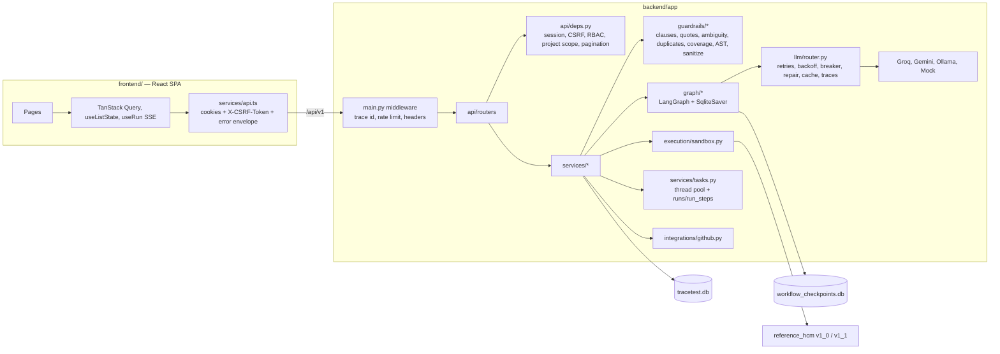
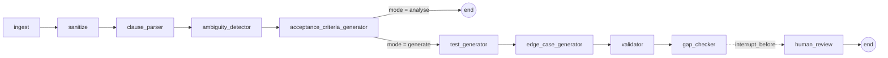

# Architecture

## Components

## Requirement-to-test graph

`POST /requirements/{id}/analyse` runs to acceptance criteria. `POST /requirements/{id}/generate-tests` runs the
full graph and stops before `human_review` with the run in `awaiting_review`. The checkpoint is persisted in SQLite;
when the last generated test receives a review decision, the API resumes the thread and the run completes. A
restart in between leaves the checkpoint intact.

## Execution and defect graph

```mermaid
flowchart LR
  approved_test --> execution_precheck_svc[execution precheck<br/>approval, validation, hash] --> sandbox_execution --> result_parser
  result_parser --> G[failure-analysis graph]
  subgraph G [graph/execution_graph.py]
    execution_precheck --> failure_classifier --> evidence_analysis --> defect_recommendation
    defect_recommendation -. interrupt_before .-> human_approval --> defect_creation
  end
  defect_creation --> retest[retest on fix build] --> reporting
```

`failure_classifier` is deterministic (timeouts, AST rejection, NameError/ImportError, network, permission,
ValueError from the engine, assertion failures). `evidence_analysis` asks the LLM for facts versus hypotheses; when
no provider is available the run continues as `degraded` with deterministic evidence only. Recommendations are
stored with `confirmed: false` until a reviewer approves.

## Data flow guarantees

- Short transactions: each node and service step opens its own session; writes are never nested across sessions
  (SQLite allows one writer).
- Background jobs commit request state before handing off, so the worker never waits on the request's write lock.
- Metrics, charts, matrix and exports are computed per request from SQLite; nothing is precomputed or hardcoded.
